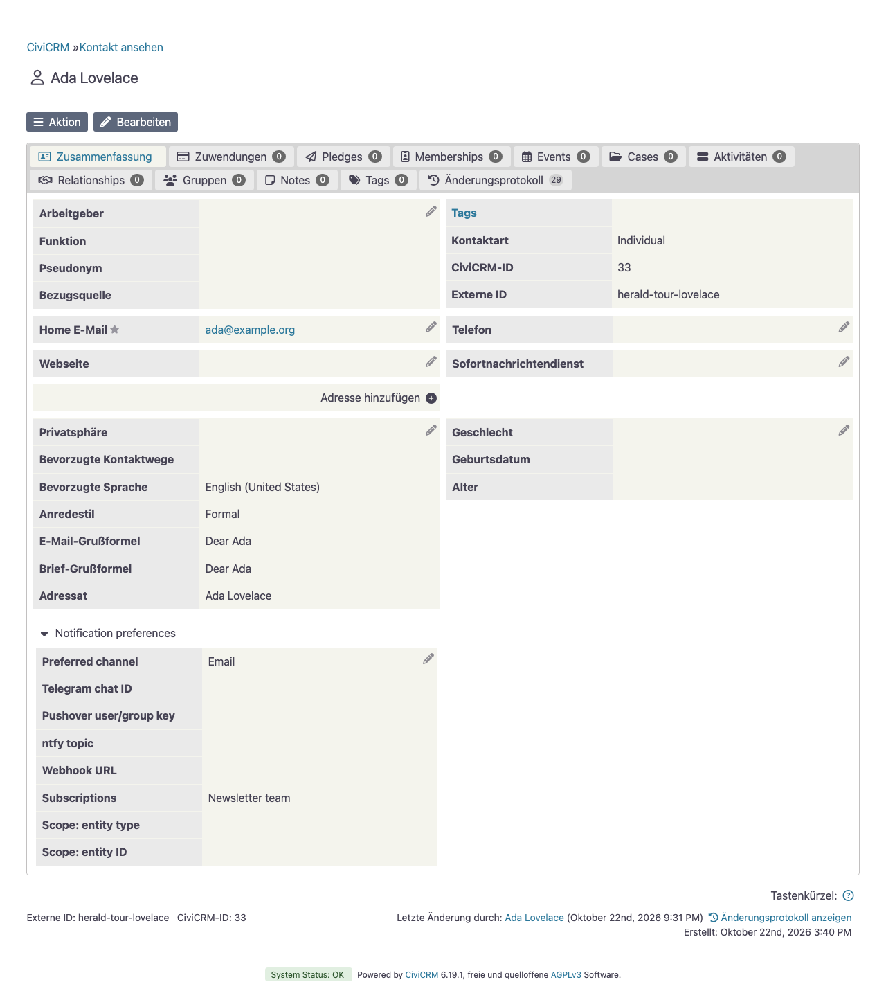
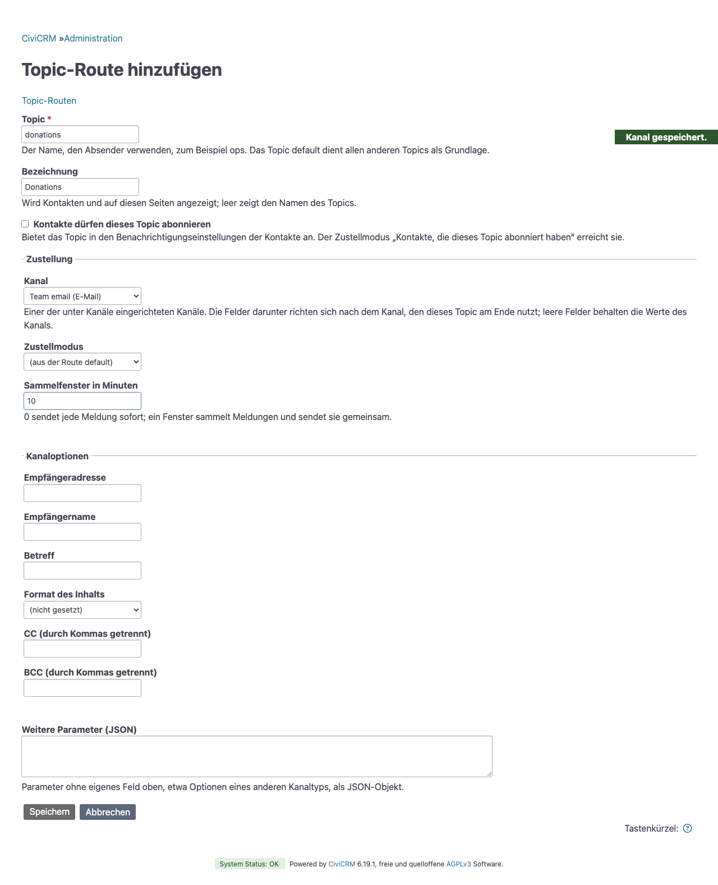
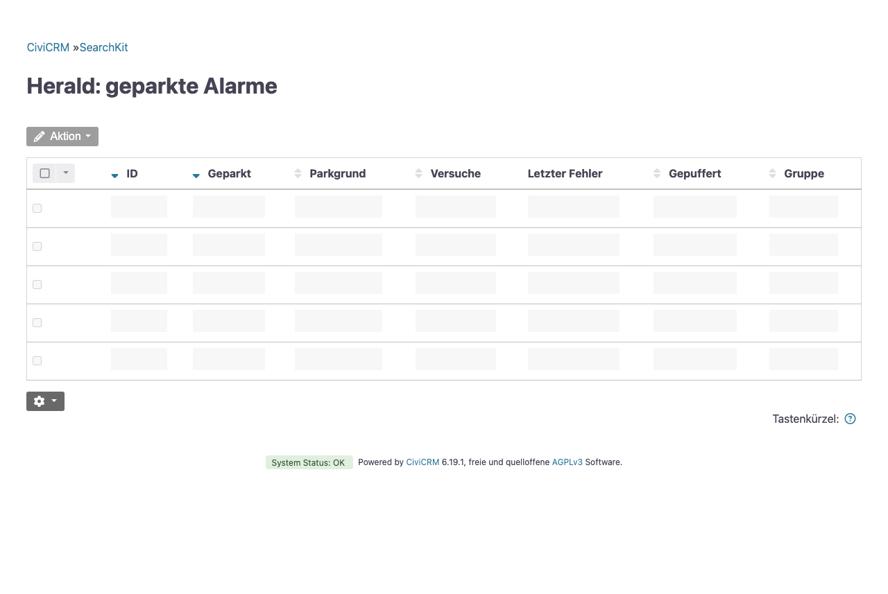

# Zustellung

Diese Seite beschreibt, wer eine Nachricht erhält, wann sie verschickt wird und was passiert, wenn sie sich nicht zustellen lässt.

## Zustellmodi

Jede CiviRules-Aktion von herald hat einen Zustellmodus. Auch Themen kennen diesen Parameter, `delivery_mode`. Im Aktionsformular heißen die Modi „Direkt“, „Abonnent:innen“, „Gruppe“ und „Adressliste“.

| Modus | Empfänger:innen | Pflichtparameter |
|---|---|---|
| `direct` | Das an der Aktion eingetragene Ziel oder der Standardwert des Kanals. Das ist der Standard. | `channel` |
| `subscribers` | Alle Kontakte, die ein Thema abonniert haben, jeweils über ihren eigenen Kanal | `subscribers_of`, das Thema. Ein Thema erreicht ohne ihn seine eigenen Abonnent:innen. |
| `group` | Alle Kontakte einer CiviCRM-Gruppe, jeweils über ihren eigenen Kanal | `group_id` |
| `addresses` | Eine Liste von E-Mail-Adressen, ganz ohne Kontaktdatensätze, über einen E-Mail-Kanal | `channel`, `email_addresses` |

Jeder andere Modus lässt den Versand scheitern. Das Aktionsformular speichert keinen Modus ohne seinen Pflichtparameter.

Im Abonnent:innen-Modus ist jedes Abo auf das Thema ein Ziel. Ein Abo, dessen Kanal fehlt oder dem das Ziel fehlt, das sein Kanal braucht, wird übersprungen.

Im Gruppenmodus spielen Themen und Bezüge keine Rolle. Ein Gruppenmitglied wird über den Kanal erreicht, den es unter [Nachrichten an Gruppen](#nachrichten-an-gruppen) gewählt hat. Ein Mitglied ohne einen solchen Kanal, oder dessen Kanal es nicht erreicht, erhält stattdessen eine E-Mail an die eigene Adresse, über den Kanal aus der Einstellung „E-Mail-Kanal für Kontakte“. Das gilt auch für ein Mitglied, dessen Gruppenkanal Telegram mit leerer Chat-ID ist.

Der Adresslisten-Modus sendet immer E-Mail, über den E-Mail-Kanal, den die Aktion nennt. Trennen Sie die Adressen durch Kommas, Semikolons oder Zeilenumbrüche. Er eignet sich für Funktionsadressen und Empfänger:innen, die keine Kontakte sind.

Gelöschte und verstorbene Kontakte erhalten nie etwas. Kontakte mit dem Vermerk „Do not email“ (keine E-Mails) erhalten nie E-Mails, unabhängig von den folgenden Optionen.

Zwei Optionen gelten für die Kontaktmodi, also Abonnent:innen und Gruppe:

| Parameter | Standard | Wirkung |
|---|---|---|
| `respect_suspension` | aus | Auch E-Mail-Empfänger:innen überspringen, die sich abgemeldet haben oder deren Adresse gesperrt ist. |
| `email_location_type` | primär | An die E-Mail-Adresse des Kontakts mit diesem Adresstyp senden. Kontakte ohne eine solche Adresse erhalten die Nachricht an ihre primäre Adresse. |

Ein Info-Eintrag im CiviCRM-Protokoll zählt, was ausgelassen wurde, nach Grund: `suspended` (gesperrt), `scope_mismatch` (Bezug passt nicht), `no_channel` (der Kanal des Abos ist gelöscht, inaktiv oder wird Kontakten nicht mehr angeboten) und `no_recipient` (keine Adresse, kein Chat, kein ntfy-Topic für den Kanal). Der Abonnent:innen-Modus zählt Abos, der Gruppenmodus Mitglieder.

Scheitert die Zustellung an einzelne Empfänger:innen, hält das die übrigen nicht auf. herald protokolliert eine Warnung und macht mit dem nächsten Kontakt weiter. Die Zustellung als Ganzes schlägt nur fehl, wenn sie bei allen Empfänger:innen fehlgeschlagen ist oder wenn es niemanden gab, an den herald senden konnte: keine Abonnent:innen, eine leere Gruppe oder eine leere Adressliste. Sobald mindestens eine Person die Nachricht erhalten hat, gilt die Zustellung als erledigt; für die gescheiterten Empfänger:innen unternimmt herald keinen weiteren Versuch.

## Abonnements

Ein Kontakt abonniert über beliebig viele Abos, jedes ein Kanal mit seinem Ziel und den Themen, die es trägt. herald ergänzt Kontakte dafür um die Gruppe benutzerdefinierter Felder „Benachrichtigungs-Abos“, eine Zeile pro Abo:

| Feld | Bedeutung |
|---|---|
| Kanal | Einer der Kanäle, die Kontakten angeboten werden, siehe [Einen Kanal konfigurieren](channels.md#einen-kanal-konfigurieren) |
| Ziel | Wohin der Kanal zustellt: eine Telegram-Chat-ID, ein Pushover-Benutzer- oder Gruppenschlüssel, ein ntfy-Topic oder eine Webhook-URL. Bei einem E-Mail-Kanal bleibt es leer für die primäre Adresse des Kontakts, oder Sie tragen eine andere Adresse ein, etwa ein Funktionspostfach. |
| Themen | Die Themen, die dieses Abo trägt |
| Bezug: Objekttyp, Bezug: Objekt-ID | Optional, siehe [Abos mit Bezug](#abos-mit-bezug) |

So erhält eine Kollegin fehlgeschlagene Zahlungen per Pushover und den Tagesbericht per E-Mail, mit zwei Zeilen. Erreichen zwei Zeilen einen Kontakt über denselben Kanal und dasselbe Ziel, kommt die Nachricht einmal an.

Beim Speichern prüft herald die Zeile: Ein Kanal außer E-Mail braucht ein Ziel, eine eingetragene E-Mail-Adresse muss eine sein, eine Webhook-URL muss dieselben Prüfungen bestehen wie beim Senden (siehe [Webhook](channels.md#webhook)), und eine Zeile braucht mindestens ein Thema. Die Vermerke des Kontakts zu E-Mails, „Do not email“ und die Abmeldung, gelten auch für eine eingetragene Adresse.

### Nachrichten an Gruppen

Eine Nachricht an eine Gruppe erreicht deren Mitglieder unabhängig von ihren Themen; wer in der Gruppe ist, entscheiden Admins. Wie solche Nachrichten ankommen, wählt jeder Kontakt einmal, unter „Nachrichten an Gruppen“ im Tab „Benachrichtigungen“ des Kontakts:

| Feld | Bedeutung |
|---|---|
| Kanal | Einer der Kanäle, die Kontakten angeboten werden. Bleibt er leer, gehen Nachrichten an die Gruppen des Kontakts per E-Mail an die primäre Adresse. |
| Ziel | Wie bei einem Abo |

Beim Speichern prüft herald das Ziel wie bei einem Abo.

### Abos verwalten

Admins bearbeiten beides im Tab „Benachrichtigungen“ des Kontakts: oben „Nachrichten an Gruppen“, darunter die Abos, mit „Abo hinzufügen“ und einem Knopf zum Entfernen jeder Zeile. Ein „Speichern“ speichert alles, und nichts, solange ein Eintrag ein Problem hat. Der Tab setzt das Recht voraus, den Kontakt zu bearbeiten.

Zur Selbstverwaltung schicken Sie den Mitarbeitenden diesen Link auf das Formular „Meine Benachrichtigungen“:

```
/civicrm/herald/my-notifications
```

Es ist dasselbe Formular für den angemeldeten Kontakt, ohne die Bezugsfelder; die Einträge anderer Kontakte erreicht niemand. Die Mitarbeitenden brauchen das Recht „access CiviCRM“.

Um die Abonnements zu nutzen, setzen Sie den Zustellmodus einer Aktion auf „Abonnent:innen“ und wählen das Thema unter „Abonnent:innen des Themas“. Das an der Aktion eingetragene Ziel wird in diesem Modus ignoriert. Die Nachricht an jede:n Abonnent:in geht über den Kanal, den die Person gewählt hat, mit dem Konto dieses Kanals, etwa seinem Bot. Von der Regel gelangen nur Darstellungsoptionen dorthin; das Aktionsformular führt sie unter „Erweitert“:

- Telegram: `parse_mode`, `disable_notification`, `disable_web_page_preview`
- Webhook: `webhook_method`, `webhook_body_format`, `webhook_body_key`
- ntfy: `ntfy_title`, `ntfy_priority`, `ntfy_tags`, `ntfy_click`, `ntfy_markdown`
- Pushover: `pushover_title`, `pushover_priority`, `pushover_sound`, `pushover_url`, `pushover_url_title`, `pushover_html`, `pushover_retry`, `pushover_expire`
- E-Mail: `email_subject`, `email_format`

Ziele, CC und BCC werden nie übernommen. Header und Token eines Webhook-Kanals gehören zu seiner Standard-URL, die eigene Webhook-URL eines Kontakts erhält sie also nie.

Kontakte abonnieren [Themen](#themen). Eine neue Installation bietet keines an. Um eines anzubieten, setzen Sie im Formular des Themas den Haken „Kontakte dürfen dieses Thema abonnieren“, oder speichern Sie es mit `cv api4 Herald.saveTopic topic=news label=News subscribable=1 'route={"delivery_mode":"subscribers"}'`. Das Thema erscheint dann unter seiner Bezeichnung im Feld „Themen“. herald hält die Optionsgruppe `herald_subscribable_topic` mit den Themen aller Domains im Einklang; bearbeiten Sie ihre Werte also nicht von Hand.

Ein Thema, das ein Eintrag in `herald_topics`, eine Regelaktion, ein Job oder eine wartende Meldung in `subscribers_of` nennt, lässt sich nicht zurückziehen. Ebenso wenig ein Thema, das danach die Abonnent:innen erreichen würde, die `default` nennt; soll es das, nennen Sie diese in seinem eigenen `subscribers_of`. Sonst gilt: Bietet sich ein Thema nicht mehr an, bleiben die Abonnements gespeichert, aber keine Zustellung erreicht sie mehr. Eine Zustellung an die Abonnent:innen eines solchen Themas scheitert mit „contacts cannot subscribe to the topic“.




### Abos mit Bezug

Ein Abo lässt sich auf einen einzelnen Datensatz beschränken, etwa auf das Event mit der ID 42. Wählen Sie dazu unter „Bezug: Objekttyp“ Event und tragen Sie unter „Bezug: Objekt-ID“ 42 ein; die Liste bietet Event, Mitgliedschaft und Teilnehmer:in. Eine Zeile mit nur einer der beiden Angaben wird beim Speichern abgewiesen. Diese Zeile erhält dann nur noch Benachrichtigungen zu diesem Event. Um zwei Events zu verfolgen, legen Sie zwei Zeilen an.

Auf welchen Datensatz sich eine Regel bezieht, legt das Feld „Abo-Bezug“ an der Aktion „Herald: Send notification (generic)“ fest. Zur Auswahl stehen Event, Mitgliedschaft und Teilnehmer:in, und herald übernimmt die ID aus dem Trigger. Event funktioniert auch bei Triggern auf Teilnahmen, über das Event der Teilnahme.

Ein Abo ohne Bezug erhält alles zu seinen Themen. Eine Zeile mit Bezug erhält keine Benachrichtigungen ohne Bezug, etwa Beitragsmeldungen, und auch keine Reports, denn die Report-Aktion hat keinen Bezug; die übrigen Zeilen des Kontakts betrifft das nicht. Das Formular zur Selbstverwaltung enthält die Bezugsfelder nicht, Admins setzen sie also am Kontakt.

## Themen

Ein Thema bündelt Nachrichten einer Art. Der Absender nennt nur das Thema, und dessen Eintrag in der Einstellung `herald_topics` entscheidet über Kanal, Empfänger:innen und Sammeln. Auch eine CiviRules-Aktion kann ein Thema nennen: Setzen Sie „Senden“ auf „Über ein Thema“. Ein Skript oder eine andere Extension muss also nie eine Chat-ID oder eine URL kennen.

Die Themen finden Sie unter Administrieren » Herald » Themen. Die Liste zeigt jedes Thema mit seinem Kanal, seinem Zustellmodus und seinem Sammelfenster. „Thema hinzufügen“ und „Bearbeiten“ öffnen ein Formular mit den Zustellfeldern und den Optionen, die der Kanal des Themas deklariert. Schlüssel ohne eigenes Feld, etwa Optionen eines anderen Kanaltyps, gehören als JSON-Objekt in „Weitere Parameter“. Beim Speichern prüft herald den Eintrag des Themas und speichert nichts, wenn es eines dieser Probleme findet: ein Kanal, der nicht konfiguriert ist, ein Kontofeld wie `bot_token`, ein Wert vom falschen Typ, ein Zustellmodus ohne seinen Pflichtparameter oder ein bereits vergebener Themenname. Ein umbenanntes Thema behält seinen Platz in der Liste. Die Spalte „Verwendet von“ listet die Regelaktionen, geplanten Jobs, Themen und den Monitor, die das Thema nennen, als Absender oder über „Abonnent:innen des Themas“, dazu wartende Meldungen an seine Abonnent:innen. Ein solches Thema lässt sich weder löschen noch umbenennen. „Löschen“ fragt vorher nach und nennt die Zahl der Abonnent:innen, falls es welche gibt; Skripte, die noch an ein gelöschtes Thema veröffentlichen, laufen danach über das Thema default.

Ein Thema hat außerdem eine Bezeichnung und kann zum Abonnieren angeboten werden. Die Bezeichnung ist der Name des Themas für Kontakte und auf diesen Seiten; leer zeigt sie den Themennamen. Der Haken „Kontakte dürfen dieses Thema abonnieren“ bietet es an, siehe [Abonnements](#abonnements). Die Spalten „Abonnierbar“ und „Abonnent:innen“ zeigen beides. Ein Thema mit Abonnent:innen lässt sich nicht umbenennen, denn ihre Abonnements nennen es. Ein Thema im Abonnent:innen-Modus erreicht seine eigenen Abonnent:innen und muss dann angeboten sein, es sei denn, es nennt in `subscribers_of` ein anderes Thema. Ein angebotenes Thema übernimmt `subscribers_of` nicht von `default`; es erreicht also die eigenen Abonnent:innen, solange sein eigener Eintrag keine anderen nennt. `default` lässt sich nicht anbieten, und beim Speichern prüft herald jedes Thema, das es verwendet.

So setzen Sie alle Themen auf einmal mit cv:

```bash
cv api4 --in=json Setting.set <<'JSON'
{"values": {"herald_topics": {
  "default": {"channel": "ops_bot"},
  "ops":     {"channel": "ops_bot", "chat_id": "-100…"},
  "revenue": {"channel": "ops_bot", "chat_id": "-100…", "aggregate_minutes": 5}
}}}
JSON
```

Dann veröffentlichen Sie:

```bash
cv api4 Herald.publish topic=ops message='🔴 disk almost full'
cv api4 Herald.publish topic=revenue template=herald_contribution_alert_completed \
    vars='{"contribution":{"total_amount":50}}' amount=50
```

Der Eintrag eines Themas nimmt dieselben Parameter auf wie eine Aktion, darunter `delivery_mode` und `aggregate_minutes`, aber keine Kontofelder. Die Werte im Eintrag des Themas überschreiben die des Themas default. Ein Thema, das nach dem Zusammenführen keinen Kanal hat, schlägt mit „the route of topic … names no channel“ fehl. Ein Thema ohne eigenen Eintrag schlägt mit dem Fehler „there is no topic“ fehl, wenn es auch kein Thema default gibt.

`Herald.publish` nimmt entweder `message` oder ein `template` mit `vars` entgegen, nie beides. Eine Nachricht ist HTML, genau wie eine gerenderte Vorlage. Mit `format=text` ist die Nachricht Klartext: Zeichen wie `<` und `&` erscheinen unverändert, auch in Kanälen, die HTML darstellen. Das Format gilt nur für Nachrichten. `amount` geht in die Summe in der Kopfzeile einer Sammelnachricht ein.

Der Check-Monitor veröffentlicht in das Thema, das in `herald_monitor_topic` steht, standardmäßig ops.




## Sammelnachrichten

Meldungen, die gehäuft auftreten, lassen sich sammeln und als eine Nachricht verschicken. Setzen Sie dazu `aggregate_minutes` an einer Aktion oder einem Thema; im Aktionsformular heißt das Feld „Sammelfenster in Minuten“ und steht unter „Erweitert“. Der Standard 0 sendet sofort.

Ein Wert über 0 legt die gerenderte Meldung in der Tabelle `civicrm_herald_buffer` ab. Der geplante Job „Herald: Sammelpuffer für Meldungen leeren“ läuft bei jedem Cron-Lauf. Sobald die älteste wartende Meldung einer Gruppe älter ist als ihr Fenster, wird die ganze Gruppe als eine Nachricht verschickt.

- Eine Gruppe entspricht einem Satz von Parametern. Regeln, deren Aktionen identische Parameter tragen, teilen sich eine Nachricht. Ändern Sie die Parameter einer Regel, beginnt eine neue Gruppe. Themen bilden eigene Gruppen.
- Ist ein Abo-Bezug gesetzt, bilden Meldungen zu verschiedenen Events, Mitgliedschaften oder Teilnahmen getrennte Gruppen.
- Eine einzelne wartende Meldung wird unverändert verschickt. Das Sammeln hat sie nur verzögert.
- Mehrere Meldungen erhalten eine Kopfzeile mit ihrer Anzahl, gefolgt von den einzelnen Nachrichten. Tragen die Meldungen einen Betrag, wie es Beitragsmeldungen tun, zeigt die Kopfzeile auch die Summe, zum Beispiel „📬 7 Meldungen, gesamt 385,00 € (gesammelt über 5 min)“. Der Betrag verwendet das Währungsformat der Site.
- Eine gesammelte E-Mail erhält diese Kopfzeile als Betreff.
- Ein Import oder eine Massenänderung des Status kann Tausende Meldungen in ein Fenster bringen. Deshalb gibt herald höchstens `herald_buffer_max_items` Nachrichten aus, standardmäßig 25. Der Rest wird als „… und N weitere“ zusammengefasst, und die Kopfzeile zählt weiterhin jede Meldung. Mit 0 gibt herald alle aus.
- Telegram kürzt eine Nachricht, die noch immer über seiner Grenze von 4096 Zeichen liegt, und vermerkt das in der Nachricht, siehe [Telegram](channels.md#telegram). Andere Kanäle senden den vollständigen Text, halten Sie `herald_buffer_max_items` also niedrig genug für deren Grenzen.
- Die längste Verzögerung ist das Fenster plus das Cron-Intervall. Wählen Sie das Fenster pro Regel, zum Beispiel 5 Minuten für Ticketverkäufe und 60 für ausstehende Spenden.

## Geparkte Meldungen

Eine wartende Gruppe, deren Zustellung fehlschlägt, bleibt im Puffer und wird beim nächsten Cron-Lauf erneut versucht. Nach `herald_buffer_max_attempts` fehlgeschlagenen Versuchen, standardmäßig 5, parkt herald sie. Eine Gruppe ohne Empfänger:innen wird sofort geparkt, weil ein weiterer Versuch nicht helfen kann. Geparkte Meldungen werden nie gelöscht; sie bleiben in der Tabelle, bis jemand sie wieder aktiviert.

Die Seite Administrieren » Herald » Geparkte Meldungen listet sie auf. Die Liste ist eine SearchKit-Anzeige auf der schreibgeschützten Entität `HeraldBufferedAlert`. Um Meldungen wieder zu aktivieren, wählen Sie ihre Zeilen aus und dann im Aktionsmenü „Geparkte Meldungen reaktivieren“; die Rückfrage nennt die Anzahl der Meldungen. Weder die Anzeige noch `Herald.getParkedAlerts` zeigt Nachrichtentexte oder Zustellparameter, weil diese Kontaktdaten enthalten können.

So listen Sie geparkte Meldungen mit cv auf und aktivieren sie wieder:

```bash
cv api4 Herald.getParkedAlerts
cv api4 Herald.reactivateParkedAlerts '{"ids": [12, 13]}'
```

Die Liste zeigt für jede Meldung die ID, den Grund des Parkens, die Anzahl der Versuche, den letzten Fehler und die Zeitpunkte. Ohne `ids` aktiviert `reactivateParkedAlerts` alle geparkten Meldungen wieder.

Für wieder aktivierte Meldungen beginnt die Zählung der Versuche von vorn. Sie behalten die Parameter, die beim Puffern gespeichert wurden. Eine Korrektur an der Regel oder am Thema korrigiert daher kein falsches Ziel, das an der Aktion eingetragen war. Empfänger:innen von Abonnements und Gruppen werden bei der Zustellung neu ermittelt, eine Korrektur an den Einstellungen eines Kontakts hilft also.

Die Systemstatus-Seite, und mit ihr der Check-Monitor, meldet geparkte Meldungen und einen hängenden Puffer, siehe [Eingebaute Checks](monitor.md#eingebaute-checks).

Wenn Sie herald deinstallieren, wird die Puffertabelle samt geparkter Meldungen gelöscht. Beim Deaktivieren von herald bleibt sie erhalten.

Zustellungen ohne Sammeln werden nie gepuffert. Schlagen sie fehl, geht der Fehler an den Aufrufer zurück, also an das API-Ergebnis oder das CiviRules-Protokoll, und es gibt keinen weiteren Versuch.


