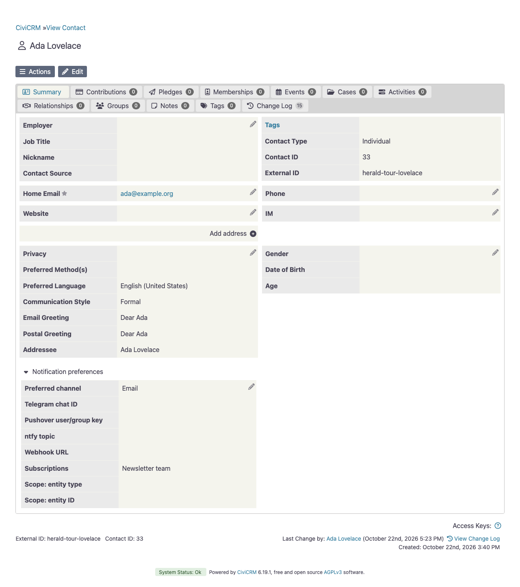
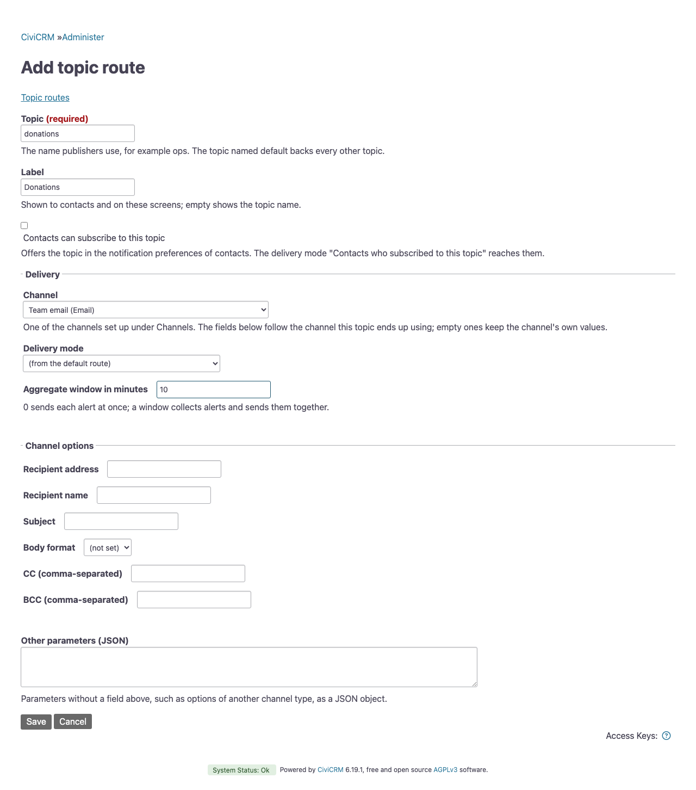

# Delivery

This page covers who receives a message, when it goes out, and what happens when it cannot be delivered.

## Delivery modes

Every herald CiviRules action has a delivery mode. Topic routes take the same parameter, `delivery_mode`. In the action form the modes are "Direct", "Subscribers", "Group" and "Address list".

| Mode | Recipients | Required parameter |
|---|---|---|
| `direct` | The recipient set on the action, or the channel's default. This is the default. | `channel` |
| `subscribers` | Every contact who subscribed to a topic, each through their own channel | `subscribers_of`, the topic. A topic route reaches its own topic's subscribers without it. |
| `group` | Every contact in a CiviCRM group, each through their own channel | `group_id` |
| `addresses` | A list of email addresses, without any contact records, through an email channel | `channel`, `email_addresses` |

Any other mode fails the send. The action form does not save a mode without its required parameter.

In subscriber mode, a contact without a chosen channel, or without the recipient that channel needs, is skipped.

In group mode, subscriptions and scopes do not matter. A group member without usable preferences gets an email at their own address instead, through the channel named in the setting "Contact email channel". That includes a member who chose Telegram but left the chat ID empty.

Address mode always sends email, through the email channel named on the action. Separate the addresses with commas, semicolons or line breaks. It suits operational recipients who are not contacts.

Deleted and deceased contacts never receive anything. Contacts marked "Do not email" never receive email, whatever the options below say.

Two options apply to the contact modes, subscribers and group:

| Parameter | Default | Effect |
|---|---|---|
| `respect_suspension` | off | Also skip email recipients who opted out or whose address is on hold. |
| `email_location_type` | primary | Send to the contact's email of this location type. Contacts without one get their primary address. |

An info entry in the CiviCRM log counts the contacts left out, by reason: `suspended`, `scope_mismatch`, `no_channel` (no channel chosen, or the chosen channel is gone, inactive or no longer offered to contacts) and `no_recipient` (no address, chat or topic for the channel).

A failed delivery to one recipient does not stop the others. herald logs a warning and moves on to the next contact. The delivery as a whole fails only when every recipient failed, or when there was nobody to send to: no subscriber, an empty group or an empty address list. Once at least one recipient got the message, the delivery counts as done, and herald does not retry the recipients it failed to reach.

## Subscribers

Each contact can choose a channel and the notifications they want. herald adds the custom field group "Notification preferences" to contacts:

| Field | Meaning |
|---|---|
| Preferred channel | One of the channels offered to contacts, see [Configuring a channel](channels.md#configuring-a-channel) |
| Telegram chat ID, Pushover user/group key, ntfy topic, Webhook URL | The recipient for the type of the chosen channel. Email needs none and uses the contact's own address. |
| Subscriptions | The topics the contact subscribed to |
| Scope: entity type, Scope: entity ID | Optional, see [Scoped subscriptions](#scoped-subscriptions) |

Admins can fill these in on the contact record. For self-service, herald installs the profile "My notification preferences". Look up its ID under Administer » Customize Data and Screens » Profiles, and send staff this link:

```
/civicrm/profile/edit?gid=<id>&reset=1
```

CiviCRM opens the profile for the logged-in contact, who can see and edit only their own record.

To use the subscriptions, set an action's delivery mode to "Subscribers" and choose the topic under "Subscribers of topic". The action's own recipient is ignored in this mode. Each subscriber's message goes through the channel they chose, with that channel's account, such as its bot. Only presentation options are passed from the rule:

- Telegram: `parse_mode`, `disable_notification`, `disable_web_page_preview`
- webhook: `webhook_method`, `webhook_body_format`, `webhook_body_key`
- ntfy: `ntfy_title`, `ntfy_priority`, `ntfy_tags`, `ntfy_click`, `ntfy_markdown`
- Pushover: `pushover_title`, `pushover_priority`, `pushover_sound`, `pushover_url`, `pushover_url_title`, `pushover_html`, `pushover_retry`, `pushover_expire`
- email: `email_subject`, `email_format`

Recipients, CC and BCC are never passed on. The headers and token of a webhook channel belong to its default URL, so a contact's own webhook URL never receives them.

Contacts subscribe to [topics](#topics). A fresh install offers none. To offer one, tick "Contacts can subscribe to this topic" on the topic's form, or save it with `cv api4 Herald.saveTopic topic=news label=News subscribable=1 'route={"delivery_mode":"subscribers"}'`. The topic then appears in the field "Subscriptions" under its label. herald keeps the option group `herald_subscribable_topic` in step with the topics of every domain, so do not edit its values by hand.

A topic that a route, a rule action, a job or a waiting alert names in `subscribers_of` cannot stop offering itself. Neither can a topic whose route would then reach the subscribers that `default` names; to keep that, name them in the route's `subscribers_of`. Otherwise, when a topic stops offering itself, the subscriptions stay stored, but no delivery reaches them any more. A delivery to the subscribers of such a topic fails with "contacts cannot subscribe to the topic".




### Scoped subscriptions

A preference record can be limited to one record, such as the event with ID 42. Set "Scope: entity type" to Event and "Scope: entity ID" to 42. That contact then receives only notifications about that event.

A rule says which record it is about with the field "Subscription scope entity" on the action "Herald: Send notification (generic)". The choices are Event, Membership and Participant, and herald takes the ID from the trigger. Event also works on participant triggers, through the participant's event.

A preference record without a scope receives everything it subscribed to. The scope applies to all subscriptions of the record. A scoped record therefore receives no notifications without a scope, such as contribution alerts, and no digests, because the digest action has no scope. The self-service profile does not include the scope fields, so admins set them on the contact.

## Topics

With topics, a publisher names a topic and the setting `herald_topics` decides the channel, the recipient and the aggregation. A CiviRules action can name a topic too: set "Send" to "Through a topic". A script or another extension never needs to know a chat ID or a URL.

The routes are under Administer » Herald » Topic routes. The list shows each topic with its channel, its delivery mode and its aggregation window. "Add topic" and "Edit" open a form with the delivery fields and the options that the topic's channel declares. Keys without a field, such as options of another channel type, go into "Other parameters" as a JSON object. Saving checks the route and stores nothing when it finds a problem: a channel that is not configured, an account field such as `bot_token`, a value of the wrong type, a delivery mode without its required parameter or a topic name that is taken. Renaming a topic keeps its place in the list. The column "Used by" lists the rule actions, scheduled jobs, topic routes and the monitor that name the topic, as publisher or through "Subscribers of topic", and waiting alerts to its subscribers. Such a topic cannot be deleted or renamed. "Delete" asks first and says how many contacts subscribed, if any; scripts that still publish to a deleted topic then use the default route.

A topic also has a label and can be offered for subscription. The label is the topic's name for contacts and on these screens; empty shows the topic name. The checkbox "Contacts can subscribe to this topic" offers it, see [Subscribers](#subscribers). The columns "Subscribable" and "Subscribers" show both. A topic with subscribers cannot be renamed, because their subscriptions name it. A route in subscriber mode reaches the subscribers of its own topic, which must then be offered, unless it names another topic in `subscribers_of`. An offered topic does not take `subscribers_of` from `default`, so its route reaches its own subscribers unless its own entry names others. `default` cannot be offered, and saving it checks every topic that uses it.

To set all routes at once with cv:

```bash
cv api4 --in=json Setting.set <<'JSON'
{"values": {"herald_topics": {
  "default": {"channel": "ops_bot"},
  "ops":     {"channel": "ops_bot", "chat_id": "-100…"},
  "revenue": {"channel": "ops_bot", "chat_id": "-100…", "aggregate_minutes": 5}
}}}
JSON
```

Then publish:

```bash
cv api4 Herald.publish topic=ops message='🔴 disk almost full'
cv api4 Herald.publish topic=revenue template=herald_contribution_alert_completed \
    vars='{"contribution":{"total_amount":50}}' amount=50
```

A route entry takes the same parameters as an action, including `delivery_mode` and `aggregate_minutes`, but no account fields. herald merges the topic's entry over the default entry. A merged route without a channel fails with "the route of topic … names no channel". A topic without an entry and without a default entry fails with the error "no route for topic".

`Herald.publish` takes either `message` or a `template` with `vars`, never both. A message is HTML, like a rendered template. With `format=text` the message is plain text: characters such as `<` and `&` appear as they are, also on channels that render HTML. The format applies to messages only. `amount` adds to the total in the header of an aggregated message.

The check monitor publishes to the topic named in `herald_monitor_topic`, which is ops by default.




## Aggregation

Alerts that come in bursts can be collected and sent as one message. Set `aggregate_minutes` on an action or a topic route; in the action form it is the field "Aggregate window in minutes". The default 0 sends at once.

A value above 0 stores the rendered alert in the table `civicrm_herald_buffer`. The scheduled job "Herald: Flush alert aggregation buffer" runs on every cron run. Once the oldest waiting alert of a group is older than its window, the whole group goes out as one message.

- A group is one set of parameters. Rules whose actions carry identical parameters share a message. Changing a rule's parameters starts a new group. Topic routes form groups of their own.
- With a subscription scope set, alerts about different events, memberships or participants form separate groups.
- A single waiting alert goes out unchanged. Aggregation only delayed it.
- Several alerts get a header with their count, followed by the individual messages. When the alerts carry an amount, as contribution alerts do, the header also shows the sum, for example "📬 7 messages, total 385.00 € (collected over 5 min)". The amount uses the site's money format.
- An aggregated email gets that header line as its subject.
- An import or a bulk status change can put thousands of alerts into one window, so at most `herald_buffer_max_items` messages are printed, 25 by default. The rest is summed up as "… and N more", and the header still counts every alert. Set 0 to print all of them.
- Telegram shortens a message that is still over its limit of 4096 characters and says so in the message, see [Telegram](channels.md#telegram). Other channels send the full text, so keep `herald_buffer_max_items` low enough for their limits.
- The longest delay is the window plus the cron interval. Choose the window per rule, for example 5 minutes for ticket sales and 60 for pending donations.

## Parked alerts

A waiting group whose delivery fails stays in the buffer and is retried on the next cron run. After `herald_buffer_max_attempts` failed tries, 5 by default, herald parks it. A group that has nobody to send to is parked at once, because retrying cannot help. Parked alerts are never deleted; they stay in the table until someone reactivates them.

Administer » Herald » Parked alerts lists them. It is a SearchKit display on the read-only entity `HeraldBufferedAlert`. To reactivate alerts, select their rows and choose "Reactivate parked alerts" from the actions menu; the confirmation names the number of alerts. Neither the display nor `Herald.getParkedAlerts` shows message bodies or delivery parameters, because they can contain contact data.

To list and reactivate parked alerts with cv:

```bash
cv api4 Herald.getParkedAlerts
cv api4 Herald.reactivateParkedAlerts '{"ids": [12, 13]}'
```

The list shows each alert's ID, the reason it was parked, the number of attempts, the last error and its dates. Without `ids`, `reactivateParkedAlerts` reactivates every parked alert.

Reactivating an alert resets its attempt count. Reactivated alerts keep the parameters stored when they were buffered. Fixing the rule or the route therefore does not repair a wrong recipient that was set on the action. Subscriber and group recipients are looked up again at delivery, so fixing a contact's preferences does help.

The check monitor reports parked alerts and a stuck buffer, see [Built in checks](monitor.md#built-in-checks).

Uninstalling herald drops the buffer table, parked alerts included. Disabling herald keeps it.

Deliveries without aggregation are never buffered. When they fail, the error goes back to the caller, which is the API result or the CiviRules log, and there is no retry.


