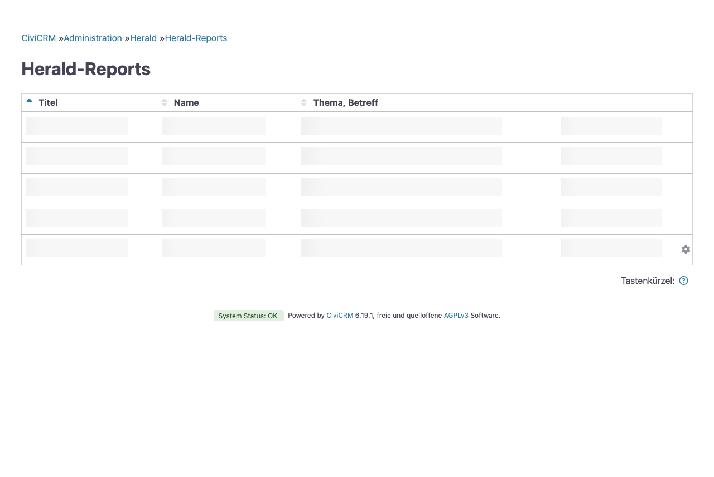
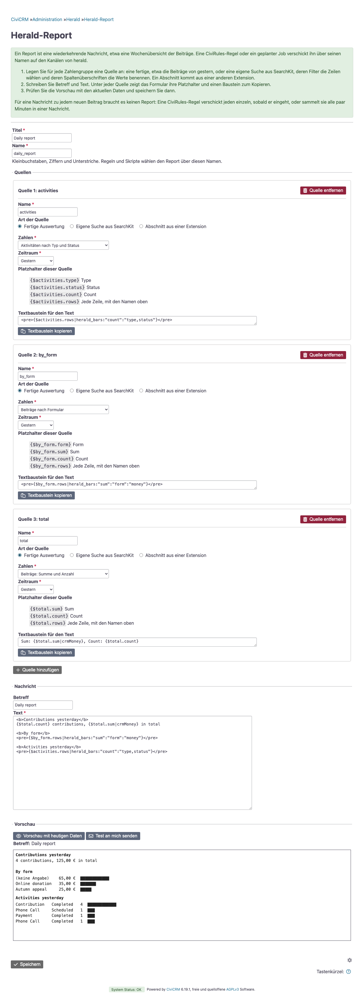
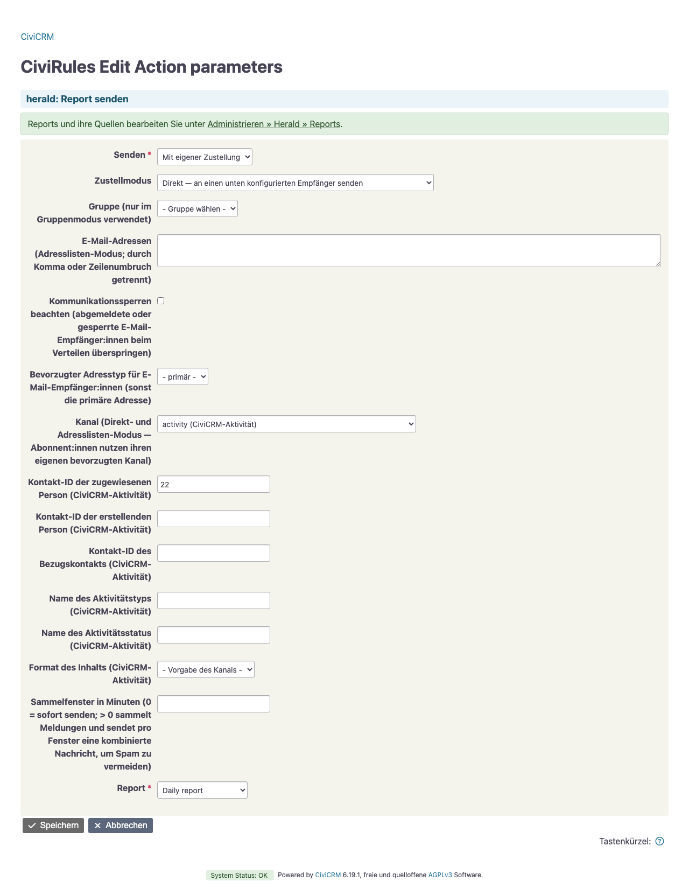

# Reports

Ein Report (im Code Digest genannt) fasst etwas in einer Nachricht zusammen, zum Beispiel die Spenden von gestern und die Aktivitäten der letzten Woche. Er besteht aus Betreff und Text, die Sie selbst schreiben, und den Quellen, die ihre Platzhalter füllen:

- eine **Suche** ist eine SearchKit-Anzeige. Ihre Spaltenüberschriften benennen die Werte, und ihre Filter bestimmen, was zählt, auch den Zeitraum;
- ein **Abschnitt** ist eine Reihe von Werten, die eine andere Extension über einen Hook liefert, für Zahlen, die keine Suche beantworten kann.

Eine Quelle namens `spenden`, die Summe und Anzahl der Beiträge von gestern zeigt, füllt `{$spenden.summe}` und `{$spenden.anzahl}`. Was die Nachricht sagt und wie sie aussieht, bestimmt der Text:

```smarty
📊 <b>Gestern</b>
Spenden: {$spenden.summe|crmMoney} ({$spenden.anzahl})
```

herald setzt Betreff und Text mit Smarty zusammen, so wie CiviCRM eine Nachrichtenvorlage.

Für eine Nachricht zu jedem neuen Beitrag braucht es keinen Report: Eine Regel verschickt jeden einzeln, sobald er eingeht, oder sammelt sie alle paar Minuten in einer Nachricht, siehe [Sammelnachrichten](delivery.md#sammelnachrichten).

## Einen Report einrichten

1. Wählen Sie unter Administrieren » Herald » Reports „Report hinzufügen“. Geben Sie einen Titel und einen Namen an.
2. Fügen Sie für jeden Teil der Nachricht eine Quelle hinzu und geben Sie ihr einen Namen wie `spenden`. Für eine fertige Auswertung wählen Sie die Zahlen und den Zeitraum, etwa „Beiträge: Summe und Anzahl“ für die letzte Woche. „Eigene Suche aus SearchKit“ nimmt stattdessen jede Anzeige vom Typ Tabelle, Liste oder Raster. Ein Abschnitt aus einer anderen Extension braucht seinen Schlüssel.
3. Unter jeder Quelle listet das Formular ihre Platzhalter und bietet einen Textbaustein an, der sie verwendet, mit bereits formatierten Beträgen und Daten. Kopieren Sie den Baustein in den Text und passen Sie ihn nach Belieben an. Dazwischen schreiben Sie, was Sie möchten.
4. Füllen Sie den Betreff aus. Bleibt er leer, ist der Titel des Reports der Betreff.
5. „Vorschau mit heutigen Daten“ setzt den Report so zusammen, wie das Formular ihn gerade enthält. Dabei wird nichts gespeichert und nichts verschickt.
6. „Test an mich senden“ schickt diesen Report per E-Mail an Ihre eigene primäre Adresse, ohne ihn zu speichern. So sehen Sie ihn, wie er ankommt. Ein Report, der sich nicht zusammensetzen lässt, wird nicht verschickt; das Formular listet seine Probleme.

Über den **Namen** wählen Regeln und Skripte den Report aus. Er besteht aus Kleinbuchstaben, Ziffern und Unterstrichen und muss eindeutig sein. Quellennamen beginnen mit einem Kleinbuchstaben, gefolgt von Kleinbuchstaben, Ziffern und Unterstrichen. Innerhalb eines Reports müssen sie verschieden sein, und `smarty` ist reserviert.

Beim Speichern prüft herald den ganzen Report, bevor es etwas schreibt: den Namen, den Text, jede Quelle und ob sich Betreff und Text mit den heutigen Werten zusammensetzen lassen. Das Formular listet jedes gefundene Problem auf. Über APIv4 bekommt jeder `HeraldDigest`- und `HeraldDigestSource`-Datensatz dieselben Feldprüfungen, und ein neuer Betreff oder Text eines gespeicherten Reports muss sich vor dem Speichern mit seinen Quellen rendern lassen. Eine Quelle, die in dem Moment nicht lädt, blockiert die Änderung nicht; sie schlägt erst beim Versand fehl.

Skripte und Deploys können einen Report mit cv anlegen. JSON über mehrere Zeilen muss über die Standardeingabe kommen, daher `--in=json`:

```bash
cv api4 --in=json HeraldDigest.create <<'JSON'
{
  "values": {"name": "weekly_report", "title": "Wochenbericht",
    "msg_subject": "Wochenbericht", "msg_html": "Spenden: {$spenden.summe|crmMoney}"},
  "chain": {"sources": ["HeraldDigestSource", "save", {
    "defaults": {"digest_id": "$id"},
    "records": [
      {"name": "spenden", "type": "search", "search_display_id": 12},
      {"name": "plaetze", "type": "section", "section_key": "myext.seats"}
    ]
  }]}
}
JSON
```





## Platzhalter

Eine Suchquelle gibt jede Wertspalte ihrer Anzeige an den Text weiter, benannt nach der Spaltenüberschrift. Der Name ist die Überschrift in Kleinbuchstaben, mit ausgeschriebenen Umlauten und `_` für jedes andere Zeichen: Aus „Plätze gesamt“ wird `{$quelle.plaetze_gesamt}`. Das Formular lehnt eine Überschrift ab, die den Namen `rows` ergibt, mit einer Ziffer beginnt oder zwei Spalten denselben Namen gibt. Benennen Sie die Überschrift dann in SearchKit um.

- `{$quelle.summe}` und die übrigen Namen enthalten die Werte der ersten Zeile. Für eine Suche mit einer einzigen Zeile, etwa eine Summe, genügt das.
- `{$quelle.rows}` enthält alle Zeilen, jede mit denselben Namen. Für eine Liste gehen Sie sie in einer Schleife durch:

  ```smarty
  {foreach from=$spenden.rows item=row}
  • {$row.formular}: {$row.summe|crmMoney}
  {/foreach}
  ```

- Ohne Zeilen ist jeder Wert leer und `rows` eine leere Liste. Eine Summe oder Anzahl ohne Zeilen ist 0.
- Die Werte kommen roh an, so wie die Suche sie liefert: Beträge als Zahlen, Daten als `2026-10-13 09:00:00`. Formatieren Sie sie im Text mit `|crmMoney` und `|crmDate`; der Textbaustein tut das bereits.

Welche Zeilen in die Nachricht kommen, entscheidet die Anzeige. Ihre Filter und ihre Sortierung gelten, ebenso ihr Limit. Eine Anzeige mit Seitenumbruch liefert nur ihre erste Seite. Geben Sie einer Anzeige, die Datensätze auflistet, ein Limit, denn jede Zeile landet in der Nachricht, und nur Telegram kürzt eine zu lange Nachricht. Wählbar sind nur Tabellen-, Listen- und Rasteranzeigen, weil die anderen Typen keine Zeilen haben. Links, Schaltflächen, Menüs, Bilder und Untersuchen liefern keine Werte.

herald führt die Anzeige ohne Berechtigungsprüfung aus. Wer einen Report einrichten darf, kann also die Zeilen jeder Anzeige an einen Kanal schicken.

### Den Text schreiben

Datum, Rechnen und Formatieren erledigt Smarty: `{"yesterday"|date_format:"%d.%m.%Y"}` gibt das Datum von gestern aus, und `{($teil * 100 / $gesamt)|round:1}` rechnet einen Prozentwert aus. Eine Division durch null bricht den Report ab, setzen Sie eine solche Rechnung daher in `{if $gesamt gt 0}…{/if}`.

Der Text ist HTML und wird genau so gespeichert, wie Sie ihn tippen. Zeilenumbrüche zählen: Telegram zeigt sie, wie sie sind, und E-Mail macht daraus `<br>`. Wie jeder Kanal das HTML darstellt, steht unter [Nachrichtenformat](channels.md#nachrichtenformat).

Ein Platzhalter mit Tippfehler wie `{$spenden.sume}` oder eine Quelle, die der Report nicht hat, ist ein Fehler und keine leere Zeile. Das prüfen das Speichern des Reports und der Versand. Lässt sich ein Report beim Versand nicht zusammensetzen, bekommen seine Empfänger eine kurze Nachricht mit dem Titel des Reports und dem Grund, und der Fehler landet zusätzlich im Protokoll.

## Mitgelieferte Suchen

herald bringt Suchen mit, die Sie direkt verwenden können. Das Formular bietet sie als fertige Auswertungen an, nach Zahlen und Zeitraum. Sie zählen keine Testbeiträge und keine Vorlagen wiederkehrender Beiträge, und sie geben keine Kontaktdaten aus:

| Anzeige | Werte |
|---|---|
| Report: Beiträge *Zeitraum* | `summe`, `anzahl` der abgeschlossenen Beiträge nach Eingangsdatum |
| … nach Formular | `formular`, `summe`, `anzahl` je Beitragsseite |
| … nach Finanztyp | `finanztyp`, `summe`, `anzahl` je Finanztyp |
| Report: Posten *Zeitraum* | `posten`, `preis`, `menge`, `summe` je Postenbezeichnung und Preis, ohne kostenlose Posten |
| Report: Beitragsbeträge *Zeitraum* | `betrag` je Beitrag |
| Report: ausstehende Beiträge | `summe`, `anzahl` aller ausstehenden Beiträge, gleich welchen Alters |
| Report: Aktivitäten *Zeitraum* nach Typ und Status | `typ`, `status`, `anzahl` |
| Report: überfällige Aktivitäten nach Typ | `typ`, `anzahl` der geplanten Aktivitäten, deren Datum verstrichen ist |

Die Beitragssuchen gibt es nur, solange CiviContribute aktiviert ist. Die Aktivitätssuchen lassen die Benachrichtigungen von herald aus, die sein Aktivitätskanal als Aktivitäten ablegt. Die Zeiträume sind heute, gestern, diese Woche, letzte Woche, letzte 7 Tage, diesen Monat, letzten Monat und dieses Jahr. Bis auf die letzten 7 Tage, die heute einschließen, sind es Kalenderzeiträume: Die letzte Woche ist die vorige volle Woche, beginnend mit dem ersten Wochentag aus den Datumseinstellungen von CiviCRM, „diese Woche“, „diesen Monat“ und „dieses Jahr“ zählen bis zum Zeitpunkt des Versands, und „heute“ ist der ganze Tag, mit den für später am Tag geplanten Aktivitäten. herald ersetzt diese Suchen bei jedem Upgrade. Für einen anderen Zeitraum oder einen Filter kopieren Sie eine davon in SearchKit und ändern die Kopie. Ihre Anzeigen behalten die Überschriften aus der Installation, in der Sprache der Seite, und die Namen folgen den Überschriften: Eine englische Seite hat `{$donations.sum}`. Ein späterer Sprachwechsel benennt sie nicht um, die Reports funktionieren also weiter. Das Formular listet die Namen jeder Anzeige auf.

## Felder bereinigen

Freitext wird oft unterschiedlich geschrieben. Eine Beitragsquelle enthält etwa die Referenz eines Zahlungsanbieters oder das Transaktionspräfix eines Bankimports, und eine danach gruppierte Suche ergibt eine Zeile je Schreibweise. Ein bereinigtes Feld gibt solchen Werten einen Namen je Gruppe. Die Einstellung `herald_cleaned_fields` enthält sie und ist standardmäßig leer.

Die Felder finden Sie unter Administrieren » Herald » Bereinigte Felder. Jeder Block nennt einen Datensatztyp und eines seiner Textfelder, darunter die Regeln: den Text, die Art des Vergleichs und den anzuzeigenden Namen. Die Pfeil-Schaltflächen ändern die Reihenfolge, in der die Regeln geprüft werden. „Name für andere Werte“ ist optional und benennt jeden Wert, auf den keine Regel passt. Beim Speichern lehnt die Seite ein Feld ab, das kein Textfeld eines Datensatztyps ist oder zweimal vorkommt, außerdem unvollständige Regeln und reguläre Ausdrücke, die sich nicht kompilieren lassen.

Jedes Feld erhält einen Zwilling namens `herald_clean_<feld>`, in den Feldlisten „(bereinigt)“, etwa `herald_clean_source` bei Beiträgen. Suchen können ihn wie jedes Feld anzeigen, filtern und gruppieren, mit der Berechtigung des Feldes selbst. Keine der mitgelieferten Suchen verwendet ihn. Für Spenden je Quelle kopieren Sie „Report: Beiträge *Zeitraum* nach Formular“ in SearchKit, gruppieren die Kopie nach der bereinigten Quelle statt nach der Beitragsseite und fügen sie mit „Eigene Suche aus SearchKit“ als Quelle hinzu.

Die Regeln greifen, wenn eine Suche läuft, nicht beim Speichern eines Datensatzes. Eine geänderte Regel gruppiert daher auch vergangene Datensätze neu, und ein Report über den letzten Monat oder dieses Jahr zeigt die neuen Gruppen für den ganzen Zeitraum.

Beitragsbenachrichtigungen zeigen den bereinigten Wert anstelle des ursprünglichen, in `{$contribution.source}` und in jedem anderen bereinigten Beitragsfeld. Andere Datensatztypen werden nur in Suchen bereinigt.

Mit cv:

```bash
cv api4 --in=json Herald.saveCleanedFields <<'JSON'
{"fields": [{"entity": "Contribution", "field": "source", "fallback": "", "rules": [
  {"match": "Bank TX", "type": "contains", "label": "Bank transfer"},
  {"match": "Transfer", "type": "prefix", "label": "Bank transfer"},
  {"match": "^pi_[A-Za-z0-9]+$", "type": "regex", "label": "Stripe"}
]}]}
JSON
```

- Die Regeln werden der Reihe nach geprüft, und der erste Treffer gewinnt.
- Der Typ ist contains, prefix oder regex. Die Groß- und Kleinschreibung zählt nicht.
- Ein regulärer Ausdruck verwendet die Syntax der Datenbank, ohne Begrenzungszeichen.
- Ein leerer Wert bleibt leer, auch mit einem Namen für andere Werte.
- Eine fehlerhafte Regel, die über `Setting.set` in die Einstellung gelangt, wird mit einer Warnung im CiviCRM-Log ausgelassen, und die übrigen Regeln gelten weiter. Ein Tippfehler kann weder eine Meldung noch eine Suche verhindern.


## Diagramme

Zwei Modifikatoren zeichnen eine Spalte der Zeilen einer Quelle als Textdiagramm. Setzen Sie sie in `<pre>`, damit die Balken bündig stehen. Der Baustein neben einer Quelle mit mehreren Zeilen enthält schon den passenden: für eine gruppierte Suche nur die Balken, weil sie jede Gruppe benennen, für jede andere die Liste und darunter ein Histogramm. Er nimmt die letzte Betragsspalte, sonst die letzte Zahl.

### Balken

`herald_bars` zeichnet je Zeile einen Balken, bemessen nach einer Zahlenspalte und benannt nach einer oder mehreren anderen Spalten, durch Kommas getrennt. Das passt zu einer gruppierten Suche wie Beiträgen nach Formular:

```smarty
<pre>{$formulare.rows|herald_bars:"summe":"formular":"money"}</pre>
<pre>{$aktivitaeten.rows|herald_bars:"anzahl":"typ,status"}</pre>
```

Jede Zeile zeigt die Namen, jeden in einer eigenen bündigen Spalte, dann Wert und Balken, und der größte Wert bekommt den vollen Balken. Balken wachsen in Achteln eines Blocks, sodass auch ein kleiner Wert sichtbar bleibt. Ein drittes Argument `"money"` schreibt den Wert als Betrag in der Währung der Website, ohne es steht er als einfache Zahl. Die Zeilen behalten die Reihenfolge des Displays. Ein leerer Name wird zu „(keine Angabe)“, und ohne einen Wert über null zeigt das Diagramm „(keine Daten)“.

### Histogramme

`herald_histogram` zeigt, wie sich die Werte einer Spalte verteilen, etwa die Beträge einzelner Beiträge:

```smarty
<pre>{$betraege.rows|herald_histogram:"betrag"}</pre>
<pre>{$betraege.rows|herald_histogram:"betrag":5}</pre>
<pre>{$betraege.rows|herald_histogram:"betrag":"0,100,1000,10000"}</pre>
```

Ohne zweites Argument zielt er auf 8 Klassen mit Grenzen, die zu den Werten passen. Eine Zahl legt die Anzahl der Klassen fest. Feste Grenzen, durch Kommas getrennt und aufsteigend, passen zu einer Kampagne mit Spendenstufen. Werte unter der ersten Grenze landen in einer zusätzlichen Klasse ab 0, Werte über der letzten in einer mit „≥“ und der Grenze. Jede Zeile zeigt die Klasse, die Anzahl mit der Summe der Klasse in Klammern und einen Balken nach der Anzahl. Leere Werte und Werte von null oder weniger werden übersprungen, und ohne Daten zeigt das Diagramm „(keine Daten)“.

## Abschnitte aus anderen Extensions

Manche Zahlen kann keine Suche beantworten, etwa gebuchte Plätze aus einer Ticket-Extension oder die Länge einer Warteschlange. Die Extension, der sie gehören, antwortet für ihren eigenen Schlüssel über `hook_civicrm_heraldDigestSections`:

```php
function myext_civicrm_heraldDigestSections(array $keys, array $context, array &$sections): void {
  if (in_array('myext.seats', $keys, TRUE)) {
    $sections['myext.seats'] = ['booked' => 138, 'paid' => 120];
  }
}
```

Eine Quelle vom Typ Abschnitt mit dem Schlüssel `myext.seats` und dem Namen `plaetze` füllt dann `{$plaetze.booked}` und `{$plaetze.paid}`. Eine Antwort enthält benannte Werte und Listen von Zeilen mit benannten Werten, mit Namen wie bei Quellen. `$context` enthält unter `digest` den Namen des Reports. Listen gehen Sie in einer Schleife durch wie `rows`.

Die Antwort enthält Werte, keinen Text: Der Text des Reports formatiert sie, und herald maskiert sie wie jede andere Variable. Ein Schlüssel, auf den keine Extension antwortet, oder eine Antwort als Text lässt den Report mit einer Meldung scheitern, die den Schlüssel nennt. So bleibt ein Tippfehler nicht unbemerkt.

## Einen Report verschicken

- Eine CiviRules-Regel mit dem Trigger „Herald: Schedule“ und der Aktion „Herald: Send digest“ verschickt einen Report zu einer festen Stunde, siehe [Geplante Reports](#geplante-reports).
- Die Aktion „Herald: Send digest“ funktioniert auch mit jedem anderen Trigger und verschickt den Report dann bei jedem Auslösen. In der Aktion wählen Sie den Report aus einer Liste und legen die Zustelleinstellungen fest.
- Skripte, die Crontab des Servers und geplante Jobs von CiviCRM können die API-Aktion `Herald.notifyDigest` direkt aufrufen, siehe [Ohne Regel](#ohne-regel).

Alle drei Wege unterstützen jeden [Zustellmodus](delivery.md#zustellmodi). Der Report hat einen eigenen Betreff; ist er leer, ist der Titel des Reports der Betreff. Die Zustelleinstellungen nehmen deshalb keinen Betreff-Schlüssel wie `email_subject` oder `activity_subject`.

### Geplante Reports

Der Trigger „Herald: Schedule“ löst einmal zur gewählten Stunde aus und bezieht sich auf keinen Kontakt. Die Regel verschickt also einen Report und nicht einen pro Datensatz.

Ein wöchentlicher Beitragsreport jeden Montag um 8:00 Uhr:

1. [Richten Sie einen Report ein](#einen-report-einrichten) mit dem Titel „Wöchentliche Beiträge“ und dem Namen `weekly_contributions`. Geben Sie ihm eine Quelle `spenden` mit der Anzeige „Report: Beiträge letzte Woche“, kopieren Sie den Textbaustein aus dem Formular in den Text und prüfen Sie die Vorschau.
2. Legen Sie unter Administrieren » CiviRules » Regeln verwalten eine Regel an und wählen Sie den Trigger „Herald: Schedule“.
3. Wählen Sie im Formular des Triggers unter „Wochentage“ den Montag und unter „Uhrzeit“ 08:00. Bleibt „Wochentage“ leer, wird der Report jeden Tag verschickt. Die Uhrzeit gilt in der Zeitzone von CiviCRM.
4. Fügen Sie die Aktion „Herald: Send digest“ hinzu, wählen Sie den Report, und setzen Sie den Kanal und bei Telegram die Chat-ID.

Die Regelliste zeigt den Zeitplan als „Jeden Montag um 08:00“ und die Aktion als `Verschickt den Report „Wöchentliche Beiträge“.` Für einen täglichen Report lassen Sie „Wochentage“ leer und verwenden die Anzeige „Report: Beiträge gestern“.

CiviRules prüft den Trigger bei jedem Lauf seines geplanten Jobs. Der Report wird also mit dem ersten Cron-Lauf nach der vollen Stunde verschickt. Ob ein Termin schon verschickt wurde, steht im Protokoll der Regel selbst:

- Verpasst Cron die Stunde, holt der nächste Lauf sie nach. Läuft Cron alle 15 Minuten, fällt aber zwischen 7:45 Uhr und 9:00 Uhr aus, wird der Report für 8 Uhr um 9:00 Uhr verschickt.
- Nach einem längeren Ausfall wird nur der jüngste Termin verschickt. Drei verpasste Montage ergeben einen Report, nicht drei.
- Eine neue Regel oder eine, deren Zeitplan gerade gespeichert wurde, verschickt nie einen Termin von vor diesem Zeitpunkt.
- Ein Lauf zählt auch, wenn das Senden fehlschlägt, etwa weil der Kanal nicht eingerichtet ist. Der Fehler wird protokolliert, und der nächste Report wird zum nächsten Termin verschickt.

CiviCRM führt geplante Jobs, auch den von CiviRules, nur in der Umgebung Production aus.




### Ohne Regel

Die Crontab des Servers kann `Herald.notifyDigest` zu einer festen Uhrzeit aufrufen. Dieser Aufruf ist nicht auf die Umgebung Production beschränkt:

```
0 8 * * 1 cd /var/www/example.org && cv api4 Herald.notifyDigest '{"checkPermissions": false, "digest": "weekly_contributions", "actionParams": {"channel": "telegram", "chat_id": "-1001234567890"}}'
```

Ein geplanter Job von CiviCRM für `Herald.notifyDigest`, auf Hourly (stündlich) gestellt und mit `"sendHour": 8` in den Parametern, funktioniert ebenfalls. Er kann aber keine Wochentage wählen und kann einen Tag auslassen. Ein stündlicher Job läuft erst wieder, wenn seit seinem letzten Lauf eine volle Stunde vergangen ist. Läuft Cron alle 15 Minuten und lief der Job um 7:45:05 Uhr, kommt der Cron-Lauf um 8:45 Uhr ein paar Sekunden zu früh. Der Job läuft erst um 9:00 Uhr wieder, und die Stunde ab 8 Uhr bekommt an diesem Tag keinen Lauf.

Mit `"daily": true` kann der Job stattdessen bei jedem Cron-Lauf laufen: Stellen Sie ihn auf Always und tragen Sie `"sendHour": 8, "daily": true` in die Parameter ein. Der Report wird dann mit dem ersten Cron-Lauf ab 8 Uhr verschickt, einmal am Tag. Mit `"skipEmpty": true` bleibt er an einem Tag aus, an dem seine Suchen nichts gefunden haben.

`Herald.notifyDigest` nimmt entgegen:

| Parameter | Bedeutung |
|---|---|
| `digest` | Der Name des Reports. Pflicht. |
| `actionParams` | Die Zustelleinstellungen, etwa `channel`, `chat_id` oder `delivery_mode`, oder ein `topic`, dessen Einstellungen die Zustellung bestimmen. Eine eigene Zustellung braucht einen `channel`. |
| `sendHour` | Optional. Der Report wird nur in dieser Stunde verschickt, von 0 bis 23 in der Zeitzone von CiviCRM. In jeder anderen Stunde gibt der Aufruf `skipped` zurück und sendet nichts, und ein Wert außerhalb von 0 bis 23 ist ein Fehler. Lassen Sie den Parameter weg, wenn Sie einen Report von Hand auslösen. |
| `daily` | Optional, zusammen mit `sendHour`. Der Report wird beim ersten Aufruf ab `sendHour` verschickt, einmal am Tag. So kann ein geplanter Job ihn bei jedem Cron-Lauf aufrufen. Spätere Aufrufe am selben Tag geben `skipped` mit `sent_on` zurück. Jede Zustelleinstellung zählt für sich. Ein Aufruf zählt als Versand des Tages, bevor etwas verschickt wird: Ein Report, der scheitert oder leer ist, wird erst am nächsten Tag wieder versucht. `daily` ohne `sendHour` ist ein Fehler. |
| `skipEmpty` | Optional. Ist jede Quelle eine Suchanzeige ohne Zeilen, gibt der Aufruf `skipped` mit `empty` zurück und verschickt nichts. Ein Abschnitt aus einer Extension gilt immer als etwas zu berichten, ebenso ein Report ohne Quellen. Eine Suche, die nur zusammenfasst, etwa eine Anzahl ohne Gruppierung, hat immer eine Zeile und gilt nie als leer. |

### Was eine Änderung kaputt macht

Regeln und Skripte wählen einen Report über seinen Namen. Nachdem Sie den Namen eines Reports geändert oder den Report gelöscht haben, scheitern sie mit der Fehlermeldung `Den Report „weekly_report“ gibt es nicht.`, bis sie einen anderen nennen. Die Regelliste zeigt dieselbe Meldung anstelle des Reporttitels. Den Titel können Sie jederzeit ändern.

Wird die Anzeige einer Quelle gelöscht, fehlt sie dem Report. Er scheitert dann beim Versand mit der Meldung, die auch das Formular zeigen würde. Wählen Sie eine andere Anzeige oder entfernen Sie die Quelle.
