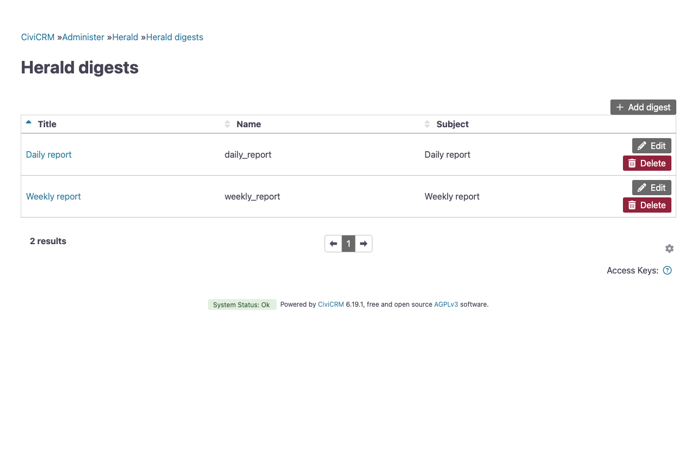
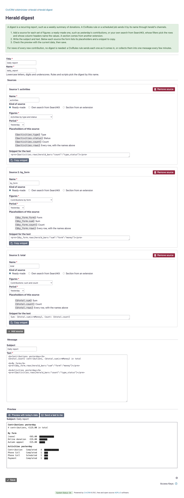
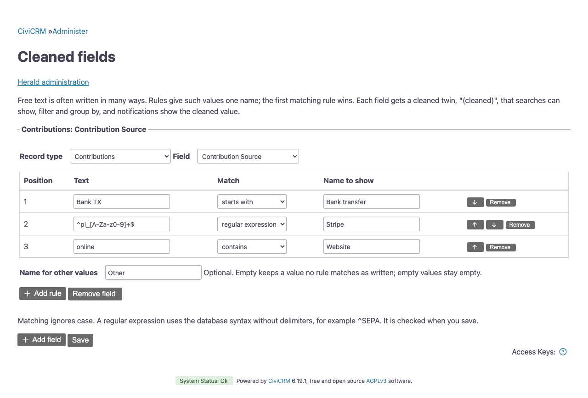
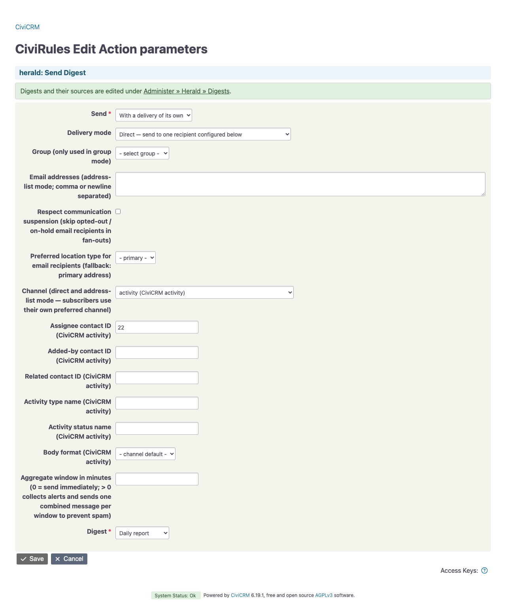

# Digests

A digest sums things up in one message, for example yesterday's donations and last week's activities. It is a subject and a text that you write yourself, plus the sources that fill their placeholders:

- a **search** is a SearchKit display. Its column headers name the values, and its filters decide what counts, including the period;
- a **section** is a set of values another extension provides through a hook, for numbers no search can answer.

A source named `donations` that shows the sum and the count of yesterday's contributions fills `{$donations.sum}` and `{$donations.count}`. The text decides what the message says and how it looks:

```smarty
📊 <b>Yesterday</b>
Donations: {$donations.sum|crmMoney} ({$donations.count})
```

herald renders subject and text with Smarty, as CiviCRM renders a message template.

For news of every new contribution, no digest is needed: a rule sends each one as it comes in, or collects them into one message every few minutes, see [Aggregation](delivery.md#aggregation).

## Setting up a digest

1. Under Administer » Herald » Digests, choose "Add digest". Give it a title and a name.
2. Add a source for each part of the message and give it a name, such as `donations`. For a ready-made source, pick the figures and the period, for example "Contributions: sum and count" for last week. "Own search from SearchKit" takes any table, list or grid display instead. A section from another extension takes its key.
3. Below each source the form lists its placeholders and offers a snippet that uses them, with amounts and dates already formatted. Copy the snippet into the text and change it as you like. Write anything you like between them.
4. Fill in the subject. Left empty, the digest's title is the subject.
5. "Preview with today's data" composes the digest as the form holds it. It saves and sends nothing.
6. "Send a test to me" emails that digest to your own primary address, without saving it, so you see it as it arrives. A digest that does not compose is not sent; the form lists its problems.

The **name** is what rules and scripts use to pick the digest. It takes lowercase letters, digits and underscores, and no two digests share one. Source names start with a lowercase letter, followed by lowercase letters, digits and underscores. They must differ within a digest, and `smarty` is reserved.

Saving checks the whole digest before anything is written: the name, the text, every source, and whether subject and text compose with today's values. The form lists every problem it finds. Through APIv4, each `HeraldDigest` and `HeraldDigestSource` record gets the same field checks, and a new subject or text of a stored digest must render with its sources before it is saved. A source that does not load at that moment does not block the edit; it fails when the digest is sent.

Scripts and deploys can create a digest with cv. JSON spread over several lines has to come through standard input, hence `--in=json`:

```bash
cv api4 --in=json HeraldDigest.create <<'JSON'
{
  "values": {"name": "weekly_report", "title": "Weekly report",
    "msg_subject": "Weekly report", "msg_html": "Donations: {$donations.sum|crmMoney}"},
  "chain": {"sources": ["HeraldDigestSource", "save", {
    "defaults": {"digest_id": "$id"},
    "records": [
      {"name": "donations", "type": "search", "search_display_id": 12},
      {"name": "seats", "type": "section", "section_key": "myext.seats"}
    ]
  }]}
}
JSON
```





## Placeholders

A search source hands every value column of its display to the text, named after the column header. The name is the header in lowercase, with umlauts spelled out and every other character turned into `_`: "Plätze gesamt" becomes `{$source.plaetze_gesamt}`. The form refuses a header that would give the name `rows`, starts with a digit, or gives two columns the same name. Rename the header in SearchKit.

- `{$source.sum}` and the other names hold the values of the first row. A search with one row, such as a total, needs nothing more.
- `{$source.rows}` holds every row, each with the same names. Loop over it for a list:

  ```smarty
  {foreach from=$donations.rows item=row}
  • {$row.form}: {$row.sum|crmMoney}
  {/foreach}
  ```

- Without rows, every value is empty and `rows` is an empty list. A sum or a count of no rows is 0.
- The values arrive raw, as the search returns them: amounts as numbers, dates as `2026-10-13 09:00:00`. Format them in the text with `|crmMoney` and `|crmDate`; the snippet does this already.

The display decides which rows go into the message. Its filters and sort apply, and so does its limit. A display with a pager sends only its first page. Give a display that lists records a limit, because every row goes into the message and only Telegram shortens a message that is too long. Only table, list and grid displays can be picked, because the other types have no rows. Links, buttons, menus, images and subsearches give no values.

herald runs the display without permission checks. Whoever can configure a digest can therefore send the rows of any display to a channel.

### Writing the text

Smarty does the dates, the arithmetic and the formatting: `{"yesterday"|date_format:"%d.%m.%Y"}` prints yesterday's date, and `{($part * 100 / $total)|round:1}` calculates a percentage. A division by zero stops the digest, so put such a calculation inside `{if $total gt 0}…{/if}`.

The text is HTML, stored exactly as you type it. Line breaks count: Telegram shows them as they are, and email turns them into `<br>`. How each channel shows the HTML is described under [Message format](channels.md#message-format).

A placeholder with a typo, such as `{$donations.sume}`, or a source the digest does not have is an error, not an empty line. Saving the digest and sending it both check this. When a digest cannot be composed at send time, its recipients get a short notice with the digest's title and the reason, and the error also goes to the log.

## Searches herald ships

herald ships searches you can use as they are. The form offers them as ready-made sources, by figures and period. They count no test contributions and no recurring templates, and they output no contact data:

| Display | Values |
|---|---|
| Digest: contributions *period* | `sum`, `count` of completed contributions by receive date |
| … by form | `form`, `sum`, `count` per contribution page |
| … by financial type | `financial_type`, `sum`, `count` per financial type |
| Digest: line items *period* | `item`, `price`, `quantity`, `sum` per line item label and price, without free items |
| Digest: contribution amounts *period* | `amount` per contribution |
| Digest: pending contributions | `sum`, `count` of every pending contribution, whatever its age |
| Digest: activities *period* by type and status | `type`, `status`, `count` |
| Digest: overdue activities by type | `type`, `count` of scheduled activities whose date has passed |

The contribution searches exist only while CiviContribute is enabled. The activity searches leave out herald's own notifications, which the activity channel files as activities. The periods are today, yesterday, this week, last week, last 7 days, this month, last month and this year. Apart from the last 7 days, which include today, they are calendar periods: last week is the previous full week, starting on the first day of the week set in CiviCRM's date settings, this week, this month and this year count up to the moment of sending, and today is the whole day, with activities scheduled for later today. herald replaces these searches on each upgrade, so for another period or a filter, copy one in SearchKit and change the copy. Their displays keep the headers they got at install, in the site's language, and the names follow the headers: a German site has `{$donations.summe}`. A later change of language does not rename them, so digests keep working. The form lists the names of each display.

## Cleaned fields

Free text is often written in many ways. A contribution source holds a payment processor's reference or the transaction prefix of a bank import, so a search grouped by it gives one row per spelling. A cleaned field gives such values one name per group. The setting `herald_cleaned_fields` holds them and is empty by default.

The fields are under Administer » Herald » Cleaned fields. Each block names a record type and one of its text fields, then the rules: the text, how it is matched and the name to show. The arrow buttons change the order in which the rules are tried. "Name for other values" is optional and names every value no rule matches. Saving rejects a field that is not a text field of a record type, a field named twice, an incomplete rule and a regular expression that does not compile.

Each field gets a twin named `herald_clean_<field>`, "(cleaned)" in the field lists, for example `herald_clean_source` on contributions. Searches can show, filter and group by it like any field, with the permission of the field itself. None of the shipped searches uses it. For donations per source, copy "Digest: contributions *period* by form" in SearchKit, group it by the cleaned source instead of the contribution page, and add the copy as a source with "Own search from SearchKit".

The rules apply when a search runs, not when a record is saved. A changed rule therefore regroups past records too, and a digest over last month or this year shows the new groups for the whole period.

Contribution notifications show the cleaned value in place of the raw one, in `{$contribution.source}` and every other cleaned contribution field. Other record types are cleaned in searches only.

With cv:

```bash
cv api4 --in=json Herald.saveCleanedFields <<'JSON'
{"fields": [{"entity": "Contribution", "field": "source", "fallback": "", "rules": [
  {"match": "Bank TX", "type": "contains", "label": "Bank transfer"},
  {"match": "Transfer", "type": "prefix", "label": "Bank transfer"},
  {"match": "^pi_[A-Za-z0-9]+$", "type": "regex", "label": "Stripe"}
]}]}
JSON
```

- The rules are tried in order, and the first match wins.
- The type is contains, prefix or regex. Matching ignores case.
- A regex uses the database's syntax, without delimiters.
- An empty value stays empty, also with a name for other values.
- A malformed rule that reaches the setting through `Setting.set` is left out with a warning in the CiviCRM log, and the other rules still apply. A typo cannot break an alert or a search.



## Charts

Two modifiers draw a column of a source's rows as a text chart. Put them inside `<pre>`, so the bars line up. The snippet beside a source with several rows already holds the fitting one: for a grouped search the bars alone, since they name every group, and for any other the list followed by a histogram. It charts the last amount column, else the last number.

### Bars

`herald_bars` draws one bar per row, sized by a number column and named by one or more other columns, separated by commas. It suits a grouped search such as contributions by form:

```smarty
<pre>{$forms.rows|herald_bars:"sum":"form":"money"}</pre>
<pre>{$activities.rows|herald_bars:"count":"type,status"}</pre>
```

Each line shows the names, each in its own aligned column, then the value and the bar, and the largest value gets the full bar. Bars grow in eighths of a block, so a small value still shows. A third argument `"money"` writes the value as an amount in the site's currency; without it the value is a plain number. Rows keep the order of the display. An empty name becomes "(none)", and without a value above zero the chart says "(no data)".

### Histograms

`herald_histogram` shows how the values of a column spread, such as the amounts of single contributions:

```smarty
<pre>{$amounts.rows|herald_histogram:"amount"}</pre>
<pre>{$amounts.rows|herald_histogram:"amount":5}</pre>
<pre>{$amounts.rows|herald_histogram:"amount":"0,100,1000,10000"}</pre>
```

Without a second argument, it aims for 8 buckets with edges that fit the values. A number sets the number of buckets. Fixed edges, separated by commas and in ascending order, suit a campaign with donation tiers. Values below the first edge land in an extra bucket from 0, values above the last in one labelled "≥" and the edge. Each line shows the bucket, the count with the bucket's sum in brackets, and a bar sized by the count. Empty values and values of zero or less are skipped, and with nothing to show the chart says "(no data)".

## Sections from other extensions

Some numbers no search can answer, such as booked seats from a ticketing extension or the depth of a queue. The extension that owns them answers for its own key through `hook_civicrm_heraldDigestSections`:

```php
function myext_civicrm_heraldDigestSections(array $keys, array $context, array &$sections): void {
  if (in_array('myext.seats', $keys, TRUE)) {
    $sections['myext.seats'] = ['booked' => 138, 'paid' => 120];
  }
}
```

A source of type section with the key `myext.seats` and the name `seats` then fills `{$seats.booked}` and `{$seats.paid}`. An answer holds named values and lists of rows of named values, with names as for sources. `$context` holds the digest's name under `digest`. Lists are looped over as `rows` are.

The answer holds values, not text: the digest's text formats them, and herald escapes them like every other variable. A key that no extension answers, or an answer that is text, fails the digest with a message that names the key, so a typo does not go unnoticed.

## Sending a digest

- A CiviRules rule with the trigger "Herald: Schedule" and the action "Herald: Send digest" sends a digest at a set hour, see [Scheduled digests](#scheduled-digests).
- The action "Herald: Send digest" works with any other trigger too, and sends the digest each time that trigger fires. The action picks the digest from a list and holds the delivery settings.
- Scripts, the server's crontab and CiviCRM's scheduled jobs can call the API action `Herald.notifyDigest` directly, see [Without a rule](#without-a-rule).

All three ways support every [delivery mode](delivery.md#delivery-modes). The subject is the digest's own, and a digest without a subject sends its title. Delivery settings therefore take no subject key such as `email_subject` or `activity_subject`.

### Scheduled digests

The trigger "Herald: Schedule" fires once at the chosen hour and carries no contact, so the rule sends one digest, not one per record.

A weekly contribution digest every Monday at 8:00:

1. [Set up a digest](#setting-up-a-digest) with the title "Weekly contributions" and the name `weekly_contributions`. Give it a source `donations` with the display "Digest: contributions last week", copy the snippet the form offers into the text, and check the preview.
2. Create a CiviRules rule under Administer » CiviRules » Manage Rules and choose the trigger "Herald: Schedule".
3. In the trigger's form, choose Monday under Weekdays and 08:00 under Time. Leave Weekdays empty to send every day. The time is in CiviCRM's timezone.
4. Add the action "Herald: Send digest", pick the digest, and set the channel and, for Telegram, the chat ID.

The rule list shows the schedule as "Every Monday at 08:00" and the action as `Sends the digest "Weekly contributions".` For a daily digest, leave Weekdays empty and use the display "Digest: contributions yesterday".

CiviRules checks the trigger each time its scheduled job runs, so the digest goes out with the first cron run after the hour. Whether a slot has been sent is read from the rule's own log:

- If cron misses the hour, the next run catches up. When cron runs every 15 minutes but skips everything between 7:45 and 9:00, the 8 o'clock digest goes out at 9:00.
- After a longer outage, only the latest slot is sent. Three missed Mondays give one digest, not three.
- A new rule, or one whose schedule was just saved, never sends for a slot from before that moment.
- A run counts even when the send fails, for example because the channel is not configured. The error is logged, and the next digest goes out at the next slot.

CiviCRM runs scheduled jobs, the CiviRules job included, only in the Production environment.




### Without a rule

The server's crontab can call `Herald.notifyDigest` at a fixed time. This call is not limited to the Production environment:

```
0 8 * * 1 cd /var/www/example.org && cv api4 Herald.notifyDigest '{"checkPermissions": false, "digest": "weekly_contributions", "actionParams": {"channel": "telegram", "chat_id": "-1001234567890"}}'
```

A CiviCRM scheduled job of `Herald.notifyDigest`, set to Hourly with `"sendHour": 8` in its parameters, also works, but it cannot pick weekdays and it can skip a day. An hourly job runs again only once a full hour has passed since its last run. With cron every 15 minutes and a run at 7:45:05, the cron run at 8:45 comes a few seconds too early, the job next runs at 9:00, and the 8 o'clock hour gets no run that day.

Add `"daily": true` and the job can run on every cron run instead: set it to Always with `"sendHour": 8, "daily": true` in its parameters, and the digest goes out with the first cron run at or after 8 o'clock, once a day. With `"skipEmpty": true` it stays unsent on a day its searches found nothing.

`Herald.notifyDigest` takes:

| Parameter | Meaning |
|---|---|
| `digest` | The name of the digest. Required. |
| `actionParams` | The delivery settings, such as `channel`, `chat_id` or `delivery_mode`, or a `topic` whose route delivers. A delivery of its own needs a `channel`. |
| `sendHour` | Optional. The digest goes out only during this hour, from 0 to 23 in CiviCRM's timezone. In any other hour the call returns `skipped` and sends nothing, and a value outside 0 to 23 is an error. Leave it out when you send a digest by hand. |
| `daily` | Optional, with `sendHour`. The digest goes out on the first call at or after `sendHour`, once a day, so a scheduled job can call it on every cron run. Later calls that day return `skipped` with `sent_on`. Each set of delivery settings counts on its own. A call counts as the day's send before anything goes out, so a digest that fails or is empty is not tried again until the next day. `daily` without `sendHour` is an error. |
| `skipEmpty` | Optional. When every source is a search display without rows, the call returns `skipped` with `empty` and sends nothing. A section from an extension always counts as something to report, and so does a digest without sources. A search that only totals, such as a count without grouping, always has one row and never counts as empty. |

### What a change breaks

Rules and scripts pick a digest by its name. After you change a digest's name or delete it, they fail with the message `Digest "weekly_report" does not exist.` until they name another. The rule list shows the same message in place of the digest's title. The title can change freely.

Deleting a source's display leaves the digest without it. It then fails when it is sent, with the message the form would show. Pick another display or remove the source.
