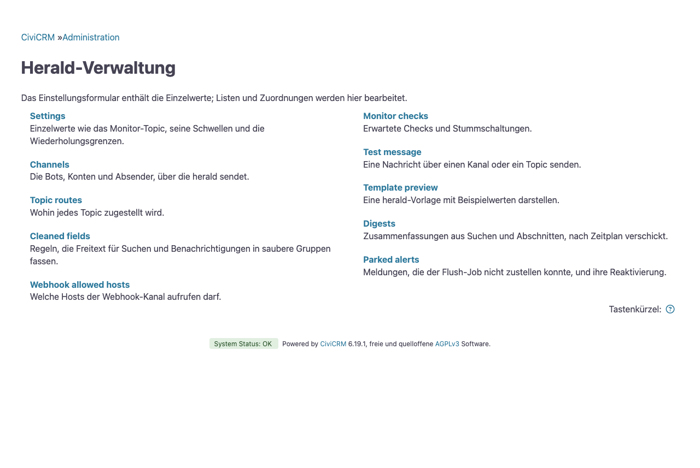

# herald

herald ist eine CiviCRM-Extension, die Benachrichtigungen und Reports verschickt. Eine CiviRules-Regel, ein geplanter Job, eine andere Extension oder ein Skript übergibt herald eine Nachricht oder eine Vorlage. herald rendert sie und stellt sie zu: in einem Chat, auf einem Smartphone, in einem Postfach oder als CiviCRM-Aktivität.

herald richtet sich an alle, die eine CiviCRM-Site betreiben und wissen möchten, was darin passiert: Eine Spende ist eingegangen, eine Überweisung ist angekommen, ein Event ist ausgebucht, ein geplanter Job ist ausgefallen. Die Meldungen richten Sie in der CiviCRM-Oberfläche ein. Extension-Entwickler:innen können herald als Zustellschicht nutzen und dort Health-Checks melden.

## Was herald kann

Der einfachste Fall ist eine E-Mail, an eine Adresse oder an alle Mitglieder einer CiviCRM-Gruppe. Sie funktioniert direkt nach der Installation: herald verschickt sie über den ausgehenden Mailversand von CiviCRM. herald kann außerdem in einen Chat oder auf ein Smartphone senden oder eine CiviCRM-Aktivität zuweisen, siehe [Kanäle](channels.md).

Meldungen stammen aus CiviCRM-Nachrichtenvorlagen, sodass Admins den Wortlaut unter „Mailings, Message Templates“ (Mailings, Nachrichtenvorlagen) anpassen können. herald bringt Vorlagen für Beiträge, Ticketverkäufe, Events, Mitgliedschaften, Gruppenanmeldungen und Health-Checks mit, auf Englisch mit deutscher Übersetzung. Ein Report hat einen eigenen Betreff und Text, siehe unten.

Ist CiviRules installiert, ergänzt herald es um vier Bausteine:

- die Aktion „Herald: Send notification (generic)“, die eine Vorlage mit den Daten des Triggers rendert
- die Aktion „Herald: Send digest“, die einen Report verschickt
- den Trigger „Herald: Schedule“, der an gewählten Wochentagen einmal zu einer festen Stunde auslöst
- die Bedingung „Herald: Field transition“, die den Wert eines Feldes vor und nach einer Änderung vergleicht, etwa wenn ein Event deaktiviert wird. CiviRules bringt solche Bedingungen nur für wenige Felder mit, etwa für Status.

Eine Benachrichtigung kann an ein einzelnes Ziel gehen, an alle Kontakte, die ihr Thema abonniert haben, an die Mitglieder einer Gruppe oder an eine Liste von E-Mail-Adressen. Jeder Kontakt kann seinen eigenen Kanal wählen. Meldungen, die gehäuft auftreten, lassen sich sammeln und als eine Nachricht pro Zeitfenster verschicken. Siehe [Zustellung](delivery.md).

Skripte und andere Extensions können Nachrichten an ein benanntes Thema wie ops schicken. Ein Thema bündelt Nachrichten einer Art, und sein Eintrag legt fest, welchen Kanal und welche Empfänger:innen sie erreichen. Wer eine Nachricht schickt, muss also nie eine Chat-ID oder eine URL kennen.

Ein Report ist ein Betreff und ein Text, die aus SearchKit-Anzeigen gefüllt werden, etwa mit den Beiträgen von gestern, und aus Zahlen, die eine andere Extension liefert. Reports richten Sie unter Administrieren » Herald » Reports ein. Meist werden sie täglich oder wöchentlich verschickt, ausgelöst von einer Regel mit dem Trigger „Herald: Schedule“. Siehe [Reports](digests.md).

Der Check-Monitor liest die Checks der CiviCRM-Statusseite, die von Core und von jeder Extension. Er meldet, wenn ein Check fehlschlägt und wenn er wieder in Ordnung ist, und erinnert an Checks, die weiter fehlschlagen. Siehe [Check-Monitor](monitor.md).

## Voraussetzungen

herald benötigt SearchKit und Afform, die Teil von CiviCRM sind; die Extension-Liste führt Afform als „Form Core“. FormBuilder wird nicht gebraucht. CiviRules ist optional; wenn Sie es nutzen, braucht herald Version 3.36 oder neuer, und der Systemstatus meldet eine ältere. herald registriert seine Regel-Bausteine, egal ob Sie CiviRules vor oder nach herald installieren. Ohne CiviRules funktionieren die API, die geplanten Jobs, die Themen und der Check-Monitor weiterhin. Die unterstützten Versionen von CiviCRM und PHP stehen in der `info.xml` der Extension.

## Installation

Laden Sie das Release-Archiv von der [Release-Seite](https://github.com/civico-de/herald/releases) herunter, entpacken Sie es in das Extension-Verzeichnis Ihrer CiviCRM-Installation und aktivieren Sie die Extension:

```bash
cv ext:enable herald
```

Ein Git-Checkout enthält kein Verzeichnis `vendor/`. Führen Sie darin `composer install --no-dev` aus, bevor Sie die Extension aktivieren. Ohne `vendor/` bricht jeder Seitenaufruf mit einem Fehler ab, sobald herald aktiviert ist.

## Erste Schritte

Die Installation legt den Kanal `email` an. Senden Sie eine Testnachricht unter Administrieren » Herald » Testnachricht: Wählen Sie „Einen Kanal“, dann `email`, tragen Sie Ihre Adresse als Empfängeradresse ein und senden Sie. Oder mit cv:

```bash
cv api4 Herald.send channel=email subject='Test' message='<b>herald works</b>' \
  'config={"email_to":"you@example.org"}'
```

Richten Sie nun eine Regel ein, die jeden abgeschlossenen Beitrag meldet:

1. Öffnen Sie Administrieren » CiviRules » Regeln verwalten (englisch: Administer » CiviRules » Manage Rules), legen Sie eine Regel an und wählen Sie den Trigger „Contribution is added“ (Beitrag wird angelegt).
2. Fügen Sie die Bedingung „Contribution Status is (not) one of“ (Beitragsstatus ist (nicht) einer von) mit Completed hinzu.
3. Fügen Sie die Aktion „Herald: Send notification (generic)“ hinzu. Wählen Sie die Vorlage „Herald: Neuer abgeschlossener Beitrag“ und den Kanal `email`, und tragen Sie die Empfängeradresse ein.

Soll statt einer Adresse ein Team die Meldung bekommen, stellen Sie den Zustellmodus der Aktion auf „Gruppe“ und wählen eine CiviCRM-Gruppe. Jedes Mitglied bekommt die Meldung an seine primäre E-Mail-Adresse, außer es hat einen anderen Kanal gewählt, siehe [Zustellung](delivery.md#zustellmodi).

Für Telegram, ntfy, Pushover, einen Webhook zu Slack, Discord oder Mattermost oder CiviCRM-Aktivitäten legen Sie unter Administrieren » Herald » Kanäle einen Kanal an. [Kanäle](channels.md) listet die Felder jedes Typs auf.

Die Administrationsseite gruppiert ihre Seiten: Einrichten, Testen und Betreiben sowie erweiterte Seiten, deren Standardwerte für die meisten Seiten passen.



## Deinstallation

Beim Deinstallieren entfernt herald seine CiviRules-Bausteine, und CiviRules entfernt sie aus jeder Regel, die sie nutzt. Eine Regel ohne ihre herald-Bedingung würde danach öfter auslösen als vorher. Deshalb schaltet herald zuerst jede aktive Regel ab, die eine seiner Bedingungen oder Aktionen nutzt. Eine Regel, die auf einem herald-Trigger läuft, etwa dem Zeitplan eines Reports, funktioniert ohne ihn nicht. herald löscht sie deshalb. Das CiviCRM-Protokoll nennt die IDs der abgeschalteten Regeln und IDs und Namen der gelöschten. Beim Deinstallieren löscht herald außerdem seine Tabellen und damit die Reports und jede Meldung, die noch im Puffer wartet, auch die geparkten.

## Wie es weitergeht

- [Rezepte](recipes.md) zeigt vollständige Beispiele für Spenden, Ticketverkäufe, Events und Anmeldungen.
- [Kanäle](channels.md) beschreibt, wie Sie Kanäle konfigurieren, und die Felder, Optionen und Grenzen jedes Typs.
- [Zustellung](delivery.md) erklärt Empfänger:innen, Abonnements, Themen, das Sammeln von Meldungen und was passiert, wenn eine Zustellung fehlschlägt.
- [Reports](digests.md) beschreibt Text, Quellen, Platzhalter, die mitgelieferten Suchen, bereinigte Felder und den zeitgesteuerten Versand.
- [Check-Monitor](monitor.md) zeigt, wie Sie einen Health-Check beisteuern und die Meldungen feinjustieren.
- [Referenz](reference.md) listet die CiviRules-Aktionen, -Trigger und -Bedingungen, die API, die geplanten Jobs, die Vorlagen, die Einstellungen und die Hooks auf.
- [Deployment](deploy.md) erklärt, wie Sie herald aktualisieren, ohne die Schreibvorgänge zu stören, in denen seine Regeln laufen.
