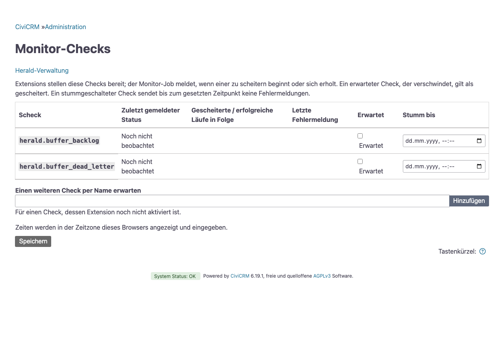

# Check-Monitor

Der Check-Monitor meldet, wenn auf der Site etwas ausfällt und wenn es wieder funktioniert. Er liest bei jedem Cron-Lauf die Meldungen der CiviCRM-Statusseite (System.check), dieselben Meldungen, die Core und jede Extension dort zeigen.

herald meldet, wenn ein Check anfängt fehlzuschlagen und wenn er wieder in Ordnung ist. Wird ein gemeldeter Fehler schlimmer oder ändert sich sein Detail, meldet herald das sofort. Solange ein Check weiter fehlschlägt, erinnert herald einmal am Tag daran.

Der geplante Job „Herald: Check-Monitor ausführen“ liest die Checks. Jeder Wechsel geht mit der Vorlage „Herald: Statuswechsel eines Monitor-Checks“ an das Thema, das in `herald_monitor_topic` steht, standardmäßig ops. Wohin die Meldungen gehen, legen Sie fest, indem Sie für dieses Thema in `herald_topics` einen Eintrag anlegen, siehe [Themen](delivery.md#themen). Ein minimaler Eintrag:

```bash
cv api4 Setting.set +v 'herald_topics={"ops": {"channel": "telegram", "chat_id": "-100…"}}'
```

Die Meldungen sehen auf einer deutschsprachigen Site so aus:

- 🔴 Check myext_queue fehlgeschlagen (Fehler)
- 🟠 Check myext_queue geändert (Kritisch)
- ⏰ Check myext_queue weiterhin gestört (Fehler)
- 🟢 Check myext_queue wieder ok

Unter der ersten Zeile folgen Titel und Text der Statusmeldung. herald wandelt das HTML der Meldung in reinen Text um, Links gehen dabei verloren; die vollständige Meldung steht auf der Statusseite.

## Check-Schlüssel

herald erkennt eine Statusmeldung an ihrem Namen. Manche Namen tragen hinter einem Doppelpunkt ein Detail, das sich ändern kann, ohne dass es ein anderer Befund wird. Core nennt zum Beispiel seine Meldung über fehlende benötigte Extensions `checkExtensionsRequired:<fehlende Extensions>`. herald teilt jeden Namen am ersten Doppelpunkt: Der Teil davor ist der Schlüssel, der Rest das Detail. Ein Name ohne Doppelpunkt ist sein eigener Schlüssel.

Zustand, Schwelle und Stummschaltung hängen am Schlüssel. Ändert sich nur das Detail eines gemeldeten Fehlers, sendet herald eine Meldung „geändert“ mit dem neuen Inhalt statt einer Entwarnung und eines neuen Fehlers. Liefert ein Lauf mehrere Meldungen mit demselben Schlüssel, zählt die höchste Stufe, und das Detail ist die sortierte Liste ihrer Details.

Den Meldungstext vergleicht herald nie. Texte wie der zum letzten Cron-Lauf enthalten Zeitangaben und ergäben in jedem Lauf eine Meldung.

Ein Schlüssel mit Zustand, der in einem Lauf keine Meldung liefert, gilt als gesund. So meldet herald auch die Erholung von Checks, die im gesunden Zustand schweigen. Einen Zustand führt herald nur für Schlüssel, die schon einmal gescheitert sind.

## Eigene Checks bereitstellen

Eine Extension ergänzt Checks über den Core-Hook `hook_civicrm_check`, sie erscheinen damit auch auf der Statusseite:

```php
function myext_civicrm_check(array &$messages): void {
  $waiting = (int) CRM_Core_DAO::singleValueQuery('SELECT COUNT(*) FROM civicrm_queue_item');
  if ($waiting > 1000) {
    $messages[] = new CRM_Utils_Check_Message(
      'myext_queue',
      ts('%1 queue items waiting.', [1 => $waiting]),
      ts('Queue backlog'),
      \Psr\Log\LogLevel::ERROR,
      'fa-tasks',
    );
  }
}
```

Ein gesunder Check liefert keine Meldung oder eine unterhalb der Schwelle. Beachten Sie diese Regeln:

- **Nicht prüfen können ist ein Fehler.** Ein Check, der nicht prüfen konnte, liefert eine Meldung auf Stufe error („Konnte nicht prüfen: …“). Er schweigt nicht und verschluckt keine Exception.
- **Der Befund steht vor dem Doppelpunkt.** Was den Befund benennt, steht im Namen vor dem Doppelpunkt, was sich an ihm ändert, dahinter. Eine ID, die einen eigenen Befund bezeichnet, bleibt Teil des Schlüssels, etwa `myext_discovery_<id>`.
- **Das letzte Ergebnis behalten.** Hängt ein Check von einem Abruf ab, etwa einem entfernten Feed, liefert er bei einem gescheiterten Abruf das letzte bekannte Ergebnis unter demselben Namen weiter und meldet den gescheiterten Abruf als eigene Meldung. Sonst meldet ein gescheiterter Abruf einen offenen Fehler als erholt.

Benennen Sie jeden Check nach seiner Extension, etwa myext_queue, damit eine Meldung verrät, woher sie stammt.

## Eingebaute Checks

herald bringt zwei eigene Checks auf die Statusseite:

| Check | Stufe | Meldet, wenn |
|---|---|---|
| herald_buffer_backlog | error | Meldungen, die auf das Sammeln warten, älter sind als das Dreifache ihres Fensters. Der Job zum Leeren des Puffers stellt nicht zu. |
| herald_buffer_dead_letter | warning | Der Puffer [geparkte Meldungen](delivery.md#geparkte-meldungen) enthält. |

Kann einer von beiden den Puffer nicht lesen, meldet er unter seinem eigenen Namen einen Fehler „Konnte nicht prüfen“.

## Schwelle

Eine Meldung zählt als Fehler, wenn ihre Stufe die Schwelle `herald_monitor_min_severity` erreicht, standardmäßig warning. Die niedrigste erlaubte Schwelle ist notice: Meldungen auf info und debug zeigen gesunde Zustände an, etwa eine aktuelle PHP-Version, und wären sonst Dauerfehler.

`herald_monitor_severity` gibt einzelnen Schlüsseln eine eigene Schwelle. Ein `*` am Ende passt auf ein Präfix, weil manche Schlüssel eine ID tragen. Der längste passende Eintrag gewinnt. herald liefert `warden_*: error` mit, damit die Warnungen von warden, die Einrichtungshinweise sind, keine Meldung auslösen.

```bash
cv api4 Setting.set +v 'herald_monitor_min_severity=warning' 'herald_monitor_severity={"warden_*": "error", "checkLastCron": "critical"}'
```

Beide Einstellungen lehnen Stufen unter notice und Schlüssel mit Leerzeichen oder Doppelpunkt ab.

## Stummschalten

Es gibt zwei Ebenen:

- **Core, für Statusseite und herald.** Wer eine Meldung auf der Statusseite ausblendet, blendet sie auch für herald aus: System.check liefert sie als nicht sichtbar. Core blendet jede Meldung über ihren vollen Namen aus, ein Schlüssel kann also sichtbare und ausgeblendete Meldungen zugleich haben; herald liest dann nur die sichtbaren, und der Schlüssel ist erst stumm, wenn alle seine fehlschlagenden Meldungen ausgeblendet sind.
- **Nur herald.** `herald_monitor_snooze` schaltet einen Schlüssel oder ein Präfix mit `*` am Ende nur für den Monitor stumm, bis zu einem Zeitpunkt oder ohne Ende. Die Statusseite zeigt die Meldung weiter. Eine Stummschaltung gilt für jedes Detail des Schlüssels.

Solange ein Check stumm ist, führt herald seinen Zustand weiter, sendet aber keine Fehlermeldung, keine Meldung „geändert“ und keine Erinnerung. Schlägt der Check beim Ende der Stummschaltung noch fehl, meldet herald den Fehler dann, mit seiner aktuellen Stufe und seinem aktuellen Detail. Eine Entwarnung folgt nur auf einen gemeldeten Fehler; diese Entwarnung geht auch dann raus, wenn der Check inzwischen stumm ist, weil sie eine Meldung schließt, die schon draußen ist. Ein Fehler, der während der Stummschaltung begann und endete, löst nichts aus.

Abgelaufene oder unlesbare Stummschaltungen entfernt herald beim nächsten Lauf.

## Erwartete Extensions

Wird eine Extension deaktiviert, verschwinden ihre Checks von der Statusseite, und herald meldet für sie höchstens eine Entwarnung. Wenn Sie stattdessen benachrichtigt werden möchten, führen Sie die Extensions, die installiert und aktiviert bleiben müssen, in `herald_monitor_expected` auf:

```bash
cv api4 Setting.set +v 'herald_monitor_expected=["myext", "org.example.other"]'
```

Eine aufgeführte Extension, die nicht installiert und aktiviert ist, schlägt als Check `herald_expected_<key>` auf Stufe error fehl, unabhängig von der Schwelle.

## Die Monitor-Seite

Administrieren » Herald » Monitor-Checks zeigt jeden Schlüssel, den System.check liefert, und jeden Schlüssel, für den der Monitor einen Zustand hat. Jede Zeile zeigt Titel, Detail, Stufe und Sichtbarkeit der Meldung, ob sie an ihrer Schwelle fehlschlägt, ob sie stummgeschaltet ist, und den Monitor-Zustand: den zuletzt gemeldeten Status, die fehlgeschlagenen und gesunden Läufe in Folge und wann zuletzt ein Fehler gemeldet wurde. Die Seite führt System.check aus, zeigt aber keine Meldungstexte und schreibt nichts.

Unter der Tabelle stellen Sie die Schwelle und ihre Ausnahmen, die Stummschaltungen und die erwarteten Extensions ein. Zeiten werden in der Zeitzone des Browsers angezeigt und eingegeben und mit Zeitzonenangabe gespeichert. „Ohne Ende“ macht eine Stummschaltung dauerhaft. Ein neues Ende, das nicht in der Zukunft liegt, wird abgelehnt. Ein Link führt zur Statusseite, auf der Meldungen in Core ausgeblendet werden.



Die übrigen Monitor-Einstellungen finden Sie auf der Einstellungsseite von herald, Administrieren » Herald » Einstellungen, alle außer dem Thema unter „Erweitert“. Dort steht auch die Schwelle:

| Einstellung | Standard | Wirkung |
|---|---|---|
| `herald_monitor_open_after` | 1 | Einen Fehler erst nach so vielen fehlgeschlagenen Läufen in Folge melden. So meldet ein Check, der zwischen gesund und fehlgeschlagen hin und her springt, nicht jeden Ausreißer. |
| `herald_monitor_close_after` | 1 | Eine Entwarnung erst nach so vielen gesunden Läufen in Folge melden. |
| `herald_monitor_renotify_hours` | 24 | Eine Erinnerung senden, wenn ein Check so viele Stunden lang fehlschlägt. 0 schaltet Erinnerungen ab. |
| `herald_monitor_topic` | ops | Das Thema, in das die Meldungen veröffentlicht werden. |

Die Einstellung `herald_monitor_state` enthält den zuletzt gemeldeten Zustand jedes Schlüssels. herald verwaltet sie selbst, bearbeiten Sie sie also nicht.

## Vorschau

`Herald.monitorPreview` listet die Schlüssel, die der nächste Lauf melden würde, mit Status, Titel, Detail, Text und Stufe. Die Action sendet nichts und schreibt keinen Monitor-Zustand. System.check selbst kann Core-Datensätze schreiben, etwa die Erinnerung an den letzten Cron-Lauf.

```bash
cv api4 Herald.monitorPreview
```

## Upgrade von Monitor-Checks über den herald-Hook

Releases vor der Umstellung auf System.check führten Checks über einen eigenen Hook unter Namen wie `pulse.updates` aus. Der Upgrade-Schritt leert den Monitor-Zustand und die Stummschaltungen, weil es die alten Namen auf der Statusseite nicht gibt. Die Namen in `herald_monitor_expected` übersetzt er anhand ihres Präfixes in Extension-Schlüssel (aus `pulse.updates` wird `pulse`). Ein unbekanntes Präfix bleibt unverändert als Schlüssel stehen; ist es keine installierte Extension, meldet der Monitor es als fehlend, und Sie korrigieren es.

Beim ersten Lauf nach dem Upgrade gilt jeder bestehende Fehler als neu. Auf einer gewachsenen Site können das ein Dutzend längst bekannter Warnungen sein. Aktualisieren Sie deshalb so:

1. Den Job „Herald: Check-Monitor ausführen“ deaktivieren.
2. herald zusammen mit den Extensions aktualisieren, die Checks geliefert haben, danach die übrigen.
3. `Herald.monitorPreview` ausführen und bekannte Warnungen auf der Statusseite oder nur in herald stummschalten.
4. Den Job wieder aktivieren.

## Garantien

- Jeder Lauf setzt eine Sperre. Ein Lauf, der sich mit einem anderen überschneidet, wird übersprungen, statt doppelt zu senden.
- Der Zustand jedes Checks wird direkt nach dem Veröffentlichen seiner Meldung gespeichert. Ein Absturz mitten im Lauf wiederholt die Meldungen davor nicht. Nur ein Absturz genau zwischen dem Veröffentlichen einer Meldung und dem Speichern des Zustands kann diese eine Meldung doppelt senden.
- Schlägt eine Veröffentlichung fehl, behält der Check seinen alten Zustand, und der nächste Lauf meldet den Wechsel erneut. Der Joblauf endet dann mit dem Fehler „herald monitor: N transition(s) could not be published, see the CiviCRM log“, und jeder Fehler steht als Warnung in diesem Protokoll.
- Hat das Thema ein Sammelfenster, landet eine Meldung zunächst nur im Puffer. Der Job zum Leeren des Puffers stellt sie später zu.

## Grenzen

Der Monitor läuft innerhalb von CiviCRM und kann deshalb keine Site melden, die nicht erreichbar ist. Verwenden Sie dafür einen externen Uptime-Monitor.
