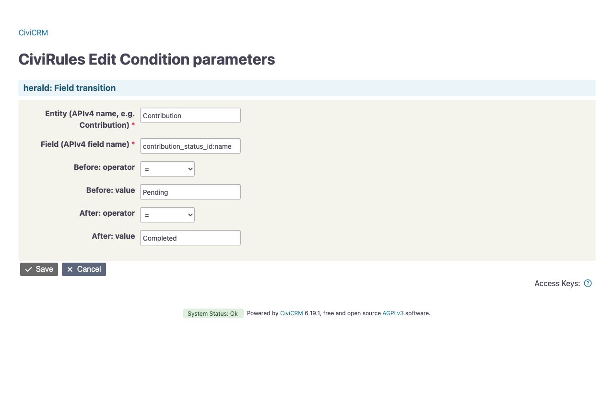
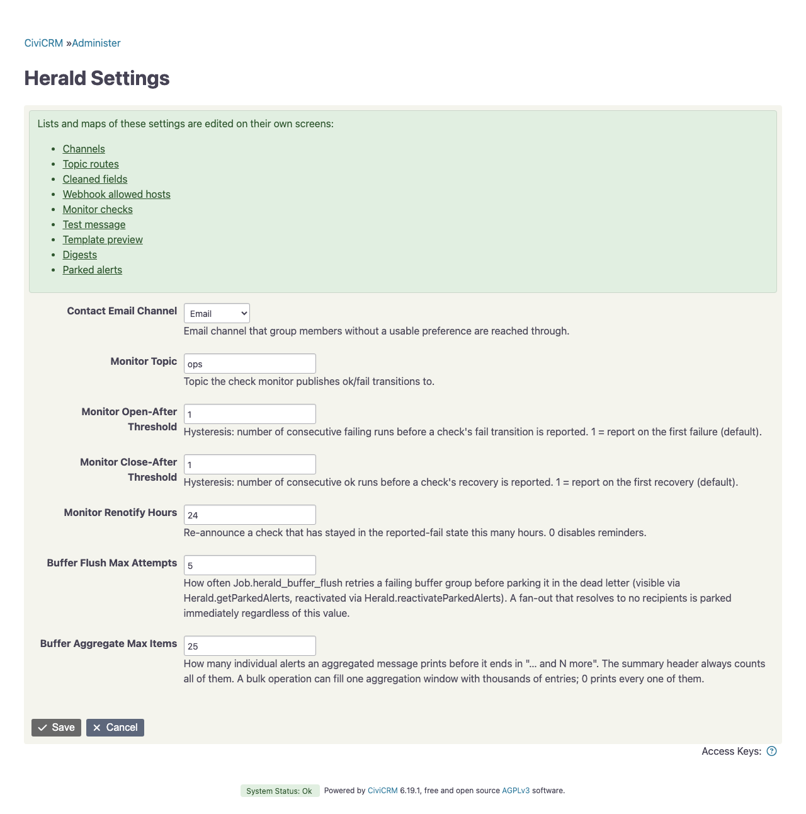

# Reference

## CiviRules actions

herald adds two CiviRules actions. Their forms share these fields:

- Send: "With a delivery of its own" or "Through a topic". The topic's entry sets channel, recipients and aggregation, see [Topics](delivery.md#topics); the delivery fields below are then hidden.
- Delivery mode, with the topic whose subscribers to reach, the group, the email addresses, the suspension option and the email location type. See [Delivery modes](delivery.md#delivery-modes).
- Channel, one of the active channels under Administer » Herald » Channels. Direct and address mode send through it. Subscribers and group members use their own channel.
- Message template.
- The recipient fields of the chosen channel's type, such as the Telegram chat ID. Empty fields keep the channel's defaults.
- Aggregate window in minutes. 0 sends at once, see [Aggregation](delivery.md#aggregation).

The suspension option, the email location type, the subscription scope, the aggregate window and the variables sit under "Advanced" at the end of the form, followed by the presentation options of each channel type, such as the ntfy priority. Direct and address mode show those of the chosen channel's type; subscriber and group mode show every type's, each under its own heading, since each contact gets the message on their own channel. "Advanced" opens by itself when one of its fields holds a value.

The forms need the permission "administer CiviCRM".


### Send notification

The action "Herald: Send notification (generic)" renders a template with the data the trigger carries, see [Trigger variables](#trigger-variables). Its form lists every template whose workflow name starts with herald_. It has two fields of its own:

| Field | Meaning |
|---|---|
| Variables | A JSON object of extra template variables. A top-level key replaces the trigger's variable of the same name as a whole, so `{"contact": {…}}` drops all generated contact fields. The form rejects invalid JSON. |
| Subscription scope entity | Event, Membership or Participant: the record the notification is about, for [Scoped subscriptions](delivery.md#scoped-subscriptions). |

On a contribution trigger, the variables also include the contribution, its campaign's progress and the status change, see [Contribution variables](#contribution-variables).


### Send digest

The action "Herald: Send digest" sends a digest each time the rule fires. In its form you pick one of the digests set up under Administer » Herald » Digests, see [Setting up a digest](digests.md#setting-up-a-digest), and fill in the delivery fields as for "Send notification". The rule list shows the action as `Sends the digest "…".` Once the digest is renamed or deleted, it shows `Digest "…" does not exist.`

## CiviRules triggers

### Schedule

The trigger "Herald: Schedule" fires once at the chosen hour on the chosen weekdays, in CiviCRM's timezone. It carries no contact. It is meant for actions such as "Herald: Send digest", see [Scheduled digests](digests.md#scheduled-digests). Its form has two fields:

| Field | Meaning |
|---|---|
| Weekdays | Any of Monday to Sunday. Empty means every day. |
| Time | The hour, from 00:00 to 23:00. |

The rule list describes the schedule, for example "Every Monday at 08:00" or "Daily at 08:00". The trigger stores `weekdays` (ISO numbers, 1 for Monday to 7 for Sunday), `hour` and `since`, the time the form was saved.

At each run of CiviRules' scheduled job, the rule fires when its latest slot is not older than the rule or than `since`, and the rule log has no run since that slot. The form needs the permission "administer CiviCRM".

## CiviRules conditions

### Field transition

The condition "Herald: Field transition" is true when a field's value before and after an edit matches what you configured.

| Field | Meaning |
|---|---|
| Entity | The APIv4 entity name, such as Contribution. Contact subtypes count as Contact. |
| Field | The APIv4 field name. A custom field is written as group.field. A field of a referenced record follows its foreign key, for example `contact_id.contact_type`. An option field takes a suffix such as `:name` to compare the option's name instead of its ID, for example `contribution_status_id:name`. Prefer `:name` to `:label`, because a label can change with the site's language. |
| Before: operator, Before: value | The test for the value before the edit. |
| After: operator, After: value | The test for the value after the edit. |

The form does not save an entity that does not exist, a field the entity does not have, a suffix the field does not offer, or a search filter such as `groups`, which holds no value. Field names are case-sensitive. The form also refuses `>`, `<`, `>=` and `<=` with a value that is not a number. An option name is text, so use these operators on the field without a suffix.

The operators are `=`, `!=`, `>`, `<`, `>=`, `<=`, `is_empty` and `not_empty`. "- any value -" leaves that side open. Any other operator, which only the API can pass, fails the condition with an error.

`>`, `<`, `>=` and `<=` need numbers on both sides. `=` and `!=` compare numbers when both sides are numbers, and trimmed text otherwise. An empty value equals an empty field. Write decimals with a point, not a comma.

Numbers compare exactly, however many digits they have. A number with an exponent, such as `1e3`, compares as a floating-point number, which is exact to about 15 digits. Money and Float fields also reach herald as floating-point numbers, and an amount of 19.99 still equals `19.99`.

- With both sides open, the condition is never true.
- With only one side configured, the value must also have changed. Unrelated edits of a record that is already in the target state therefore do not fire again. A field that stays empty has not changed.
- With both sides configured, the two tests alone decide.

The value before the edit comes from the copy CiviRules keeps of the record. For a field with a suffix, herald looks up the option of the stored ID. An empty stored value counts as empty, and a stored value without an option counts as missing. When CiviRules has no value, herald uses its own copy, taken just before the edit. When the value is still unknown, the condition is false, because a missed alert is better than a false one.

herald's own copy lasts only as long as the request, but a delayed action rechecks its conditions later, in the cron run. CiviRules keeps custom fields under different names and has no fields of referenced records, so for them herald's copy is the only source. On a delayed action with such a field, tick "Don't recheck condition upon processing of delayed action", or the condition never fires.

The value after the edit is the one this edit wrote, as CiviRules passes it on. CiviRules evaluates once the whole save is committed, and one save can write a record several times, so the stored record may already hold a later write. When the edit did not write the field, herald reads the stored record.

herald takes its copy only of fields that active rules watch. A long-running queue or command line worker sees a newly configured field only after a restart.

Examples:

| Watches | Entity | Field | Before | After |
|---|---|---|---|---|
| A membership moves from status 2 to 3 | Membership | status_id | = 2 | = 3 |
| A contribution leaves Pending | Contribution | contribution_status_id:name | = Pending | any value |
| A contribution was Pending before the edit, changed or not | Contribution | contribution_status_id:name | = Pending | not_empty |
| An event is deactivated | Event | is_active | = 1 | = 0 |



## APIv4

The entity `Herald` offers these actions. The actions need the permission "administer CiviCRM", except the metadata actions such as getFields, which need only "access CiviCRM".

| Action | Parameters | What it does |
|---|---|---|
| send | channel, message, subject, format, config | Delivers a finished message through one configured channel, named in `channel`. This is the entry point for other extensions. The result lists `unknown_config_keys`. |
| publish | topic, message or template with vars, format, amount | Delivers through the topic's entry in `herald_topics`, see [Topics](delivery.md#topics). |
| notify | actionParams, triggerContext | What "Send notification" calls. |
| notifyDigest | digest, actionParams, sendHour, daily, skipEmpty | What "Send digest" calls, and scripts, see [Sending a digest](digests.md#sending-a-digest). |
| checkSchedule | ruleId, schedule | What "Herald: Schedule" calls. Returns `due`, `slot`, `last_run` and `not_before`. |
| checkFieldTransition | entity, entityId, field, fromOperator, fromValue, toOperator, toValue, before, after | What "Field transition" calls. `before` and `after` take the values of one edit as `{"value": …}`; without `before` it uses the snapshot of the current request, without `after` the stored record. Returns `matched`. |
| getChannelTypes | type, optional | Lists the channel types and the keys they accept, with scope, secret and recipient flags. |
| getChannels | withUsage, optional | Lists the configured channels. Secrets show only as set or not. withUsage adds who names each channel. |
| saveChannel | name, channel, isNew | Validates one channel and stores it in `herald_channels`, its secrets encrypted. A secret left out or empty keeps its stored value, `null` clears it. |
| deleteChannel | name | Removes a channel. Refuses while a topic, rule action, job, buffered alert or setting names it. |
| getParkedAlerts | ids, optional | Lists [Parked alerts](delivery.md#parked-alerts) without their bodies. |
| reactivateParkedAlerts | ids, optional | Puts parked alerts back into the buffer. Without ids, all of them. |
| renderTemplate | workflow, vars | Renders a template without sending it. |
| previewDigest | digest, sources | Composes a digest from unsaved values with today's data and sends nothing. The digest form's preview calls it. |
| sendDigestTest | digest, sources | Composes like previewDigest and emails the result to the logged-in user's primary address only. Returns `sent`, `to` and `problems`; nothing is sent while there are problems. |
| getDigestPlaceholders | source, digest | The placeholders and the snippet of one source, as the digest form shows them. |
| saveTopic | topic, route, previousName | Validates one topic's entry and stores it in `herald_topics`; with previousName it renames that topic in place. The Topics screen uses this action. |
| deleteTopic | topic | Removes one topic from `herald_topics`. Refuses while a rule action, job or the monitor names it. |
| getTopicUsage | none | Lists the rule actions, jobs and the monitor that name each topic. |
| saveCleanedFields | fields | Validates and stores `herald_cleaned_fields`. Errors name the field and the rule. |
| saveAllowedHosts | hosts | Validates and stores `herald_webhook_allowed_hosts`. Blank entries are skipped. |
| getMonitorChecks | none | Lists every offered, expected, snoozed or tracked check with its stored state, without details and without running the checks. |
| saveMonitorChecks | expected, snooze | Validates and stores `herald_monitor_expected` and `herald_monitor_snooze`. A snooze must end in the future unless it is unchanged. |

The save actions store exactly the shape `Setting.set` takes. `Setting.set` still works, but it does not validate. The save actions reject invalid input with a list of every problem and then store nothing.

`send` needs a channel and a message. `publish` needs exactly one of message and template. Both reject a format other than text or html. For `publish`, the format applies to a message only, because a rendered template is always HTML.

To try a template:

```bash
cv api4 Herald.renderTemplate workflow=herald_contribution_alert_completed \
    vars='{"contribution": {"total_amount": 50, "currency": "EUR"}}'
```

The entity `HeraldBufferedAlert` is the alert buffer. Administrators can read it with get and getFields and put parked alerts back with reactivate; all three need "administer CiviCRM". Its update and delete actions are for herald's own code, and no user may call them. There is no create action: herald writes new rows itself, so the stored message text stays exactly as rendered. The body and delivery fields can contain contact data, so the shipped display of parked alerts leaves them out.

The entities `HeraldDigest` and `HeraldDigestSource` hold the digests and their sources, with the usual actions such as get, create, save and delete. They need "administer CiviCRM". Saving checks every record, see [Setting up a digest](digests.md#setting-up-a-digest), and deleting a digest deletes its sources.

Another extension can call `send` and `publish` without a hard dependency on herald:

```php
if (class_exists(\Civi\Api4\Herald::class)) {
  civicrm_api4('Herald', 'publish', ['topic' => 'ops', 'message' => 'Import finished']);
}
```

## Scheduled jobs

| Job | Comes with herald | Frequency | What it does |
|---|---|---|---|
| Herald: Flush alert aggregation buffer | yes | Always | Sends the aggregated groups whose window has passed. |
| Herald: Run check monitor | yes | Always | Runs the [Check monitor](monitor.md). |
| Herald.notifyDigest | no, create it yourself | Hourly with sendHour, or Always with sendHour and daily | Sends a digest without a rule, see [Without a rule](digests.md#without-a-rule). |

Both shipped jobs take a lock, so a run that overlaps with another one does not send twice.

## Templates

herald's templates are CiviCRM message templates. Edit them under Mailings, Message Templates, System Workflow Messages. They are rendered as Smarty templates.

| Title | Workflow name | Used for |
|---|---|---|
| Herald: New completed contribution | herald_contribution_alert_completed | A completed contribution |
| Herald: New pending contribution | herald_contribution_alert_pending | A pending contribution, such as an announced transfer |
| Herald: Contribution status changed | herald_contribution_status_changed | A status change, such as Pending to Completed |
| Herald: New ticket/event contribution | herald_contribution_alert_ticket | A ticket or event contribution |
| Herald: Ticket ordered, bank transfer announced | herald_contribution_alert_ticket_pending | A ticket ordered by transfer |
| Herald: Ticket bank transfer received | herald_contribution_alert_ticket_paid | A ticket transfer received |
| Herald: New event created | herald_event_created_alert | A new event |
| Herald: Event deactivated | herald_event_deactivated_alert | A deactivated event |
| Herald: Event deleted | herald_event_deleted_alert | A deleted event |
| Herald: New event registration | herald_event_registration_alert | A new registration, with a masked contact |
| Herald: Event registration cancelled | herald_event_cancellation_alert | A cancelled registration, with a masked contact |
| Herald: New membership signup | herald_membership_signup_alert | A new membership, with a masked contact |
| Herald: New group/newsletter subscription | herald_group_subscription_alert | A contact added to a group, with a masked contact |
| Herald: Monitor check transition | herald_monitor_alert | A change in the check monitor. Variables: check, status, detail, renotify |

The titles appear in the language CiviCRM used when it created or last updated the templates. On a German site, "Herald: New completed contribution" reads "Herald: Neuer abgeschlossener Beitrag", for example. The workflow name is the same in every language.

The templates are in English. A German translation is included and used when CiviCRM runs in German.

An edit you make to a shipped template survives until a herald release changes that template. The release then overwrites your edit. To keep a customised version, copy it under a workflow name of your own. The Message Templates form has no field for the workflow name, so add the copy there under "User-driven Messages" and then set its name with cv, for example `cv api4 MessageTemplate.update +w id=123 +v workflow_name=herald_my_alert`. The API and the scheduled jobs accept any workflow name, but the CiviRules forms list only names that start with `herald_`, so a name like `herald_my_alert` makes the copy appear there too.

herald renders only the default version of a template. Naming a template that does not exist fails with the error `MessageTemplate "…" not found. Is the herald extension enabled?`. A template with neither an HTML nor a text body fails too.

### Escaping

Templates render to HTML. String variables are HTML-escaped before they reach the HTML body, so data cannot inject markup. The subject gets them unescaped. A template with only a text body is rendered and then escaped as a whole.

Every template renders under CiviCRM's policy for user content, as message templates of mailings do: `{crmAPI}`, PHP constants and superglobals are blocked, and PHP functions only work in the few forms the policy allows, such as `|count`. Smarty's own modifiers and CiviCRM's, such as `|crmMoney`, `|crmDate` and `|round`, work as usual.

### Trigger variables

"Send notification" fills these from the trigger, when the trigger carries the record:

| Variable | Content |
|---|---|
| contact.id, contact.display_name, contact.email | The trigger's contact. The email is the primary address when there is one. |
| contact.masked_name, contact.masked_email | The same, masked. Each word keeps its first two characters, so "Jane Doe" becomes "Ja** Do*". In the email, the local part and each domain label are masked the same way, and only the top-level domain stays readable: jane@example.org becomes ja**@ex*****.org. |
| group.id, group.title | On "Contact is added to Group". |
| membership.membership_type, membership.status | On membership triggers: the type name and the status label. |
| participant.role, participant.status | On participant triggers: the first role's label and the status label. |
| event.id, event.title, event.start_date, event.is_active | On event triggers. Participant triggers give only the ID and the title. |

When a lookup fails, herald logs an error and leaves the variable out instead of failing the notification. A deleted contact or group keeps its ID with empty text fields. A deleted event keeps the values from the trigger's own data.

### Contribution variables

"Send notification" adds these when the trigger carries a contribution:

| Variable | Content |
|---|---|
| contribution | The contribution's fields, such as total_amount, currency, receive_date and source. Cleaned fields show their cleaned value, see [Cleaned fields](digests.md#cleaned-fields). |
| campaign.title, campaign.total, campaign.count | The contribution's campaign: its title and the total and number of its completed contributions. |
| campaign.goal, campaign.percent | The campaign's revenue goal and the share reached, rounded to one decimal. Both are 0 when the campaign has no goal. |
| from_status, to_status | The status names before and after the edit. from_status is empty when the status before the edit is unknown. |

Without a campaign, every campaign field is empty or 0, so `{if $campaign.goal}` hides the progress line in a template.

Digests have no fixed variables; their sources name them, see [Placeholders](digests.md#placeholders).

## Settings

Set them with `cv setting:set name=value` or `cv api4 Setting.set +v 'name=value'`. Settings that hold a list or a map take JSON. The plain settings are also on the Herald settings screen, Administer » Herald » Settings (`civicrm/admin/setting/herald`). The list and map settings have their own screens on `civicrm/admin/herald`: Channels, Topics, Cleaned fields, Webhook allowed hosts and Monitor checks. The settings screen shows the thresholds and limits under "Advanced" and links to the overview of all screens. All of them need "administer CiviCRM".

| Setting | Default | Meaning |
|---|---|---|
| `herald_channels` | one channel, `email`, created on install | The [channels](channels.md#configuring-a-channel), secrets encrypted. Edit them on the Channels screen or with `Herald.saveChannel`, not with `Setting.set`. |
| `herald_contact_email_channel` | email | The email channel that reaches group members without a channel of their own. |
| `herald_webhook_allowed_hosts` | empty | Webhook hosts that may be reached. Empty allows any public address and blocks private ones. |
| `herald_topics` | empty | [Topics](delivery.md#topics) and their delivery settings. |
| `herald_buffer_max_attempts` | 5 | Failed deliveries before an aggregated group is parked. |
| `herald_buffer_max_items` | 25 | Messages printed in one aggregated message. 0 prints all. |
| `herald_cleaned_fields` | empty | Text fields whose values rules group under one name, see [Cleaned fields](digests.md#cleaned-fields). |
| `herald_monitor_topic` | ops | The topic for monitor alerts. |
| `herald_monitor_open_after`, `herald_monitor_close_after`, `herald_monitor_renotify_hours`, `herald_monitor_snooze`, `herald_monitor_expected` | see [Tuning](monitor.md#tuning) | Monitor tuning. |
| `herald_monitor_state` | empty | The monitor's own state. Do not edit it. |



## Hooks

| Hook | Signature | Purpose |
|---|---|---|
| `hook_civicrm_heraldChecks` | `(array &$checks)` | Add checks to the monitor, see [Contributing a check](monitor.md#contributing-a-check). |
| `hook_civicrm_heraldDigestSections` | `(array $keys, array $context, array &$sections)` | Provide the values of a digest's section sources, see [Sections from other extensions](digests.md#sections-from-other-extensions). |

## System status

While a deploy has left herald's rules switched off, CiviCRM's system status shows the warning "Herald: rules disabled by a deploy". It names the IDs of the rules and the command that switches them back on. See [Deployment](deploy.md).
